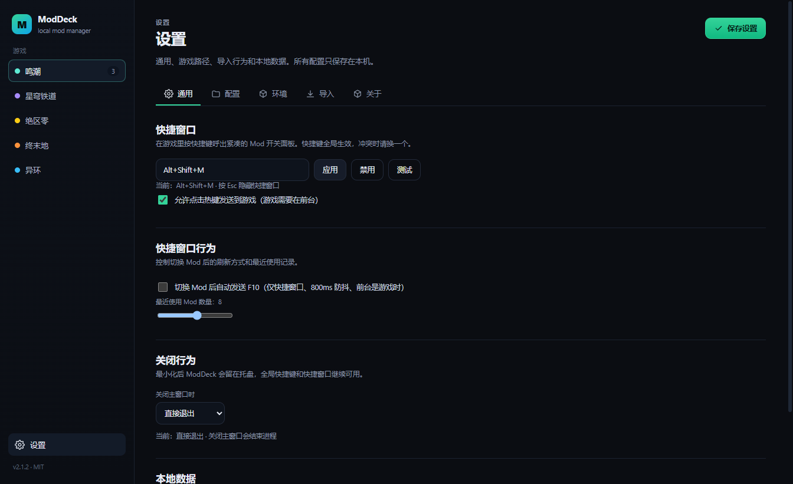

# ModDeck

[](https://github.com/yuzhoujun/ModDeck/actions/workflows/ci.yml)
[](https://github.com/yuzhoujun/ModDeck/releases/latest)
[](LICENSE)
[](#系统要求)

面向 3DMigoto / XXMI 系游戏的 Windows 本地 Mod 管理器。

ModDeck 只管理 `Mods` 目录：扫描角色和 Mod、启停、导入、排序、封面和快捷开关。
游戏注入仍然交给 XXMI / 3DMigoto，ModDeck 不修改游戏本体。

## 下载与运行

**V2.1.0 正式版**：[下载 latest Release](https://github.com/yuzhoujun/ModDeck/releases/latest)

1. 下载 `ModDeck-2.1.0-win-x64.zip`
2. 完整解压到任意目录（不要在压缩包里直接运行）
3. 双击 `ModDeck.cmd`
4. 打开“设置”，选择 EFMI 根目录或 `Mods` 目录

> 启动入口是 `ModDeck.cmd`，它内部带 `--no-sandbox`。部分安全软件会阻止 Electron 的
> Chromium 沙箱，直接双击 `ModDeck.exe` 可能没有窗口。

**系统要求**：Windows 10 / 11 x64。

## 角色库

角色和 Mod 直接来自磁盘，不依赖内置名单或在线数据库。第一次连接现有库时，当前角色会
被登记为“已有”，之后新增的目录才显示“新”。

- 角色筛选：全部 / 仅有 Mod / 仅无 Mod
- 搜索显示名、别名、目录名
- 拖动卡片自定义排序，顺序保存在本机
- 新增角色或“功能 Mod”目录
- `.` 和 `_` 开头的目录自动隐藏


## 角色详情与封面

角色封面优先读取角色目录下的 `.preview.png / .jpg / .webp`。
在“编辑角色”里可以拖入或选择图片，拖动、缩放裁剪成 1:1 后保存为 `.preview.png`。


## Mod 管理

- 点击 Mod 在右侧查看预览、大小、文件数、ini 文件和热键
- **Mod 预览图**：自动读取 Mod 目录（及非贴图一级子目录）内的 `preview / cover` 图片；也支持在右侧 Mod 详情面板中**直接拖入图片或点击选择图片**，自动复制保存为该 Mod 的专属预览图（`.preview.*`）
- 启用 / 禁用通过 `DISABLED_` 前缀完成；当游戏运行中占用子目录资源导致外层目录无法改名时，自动回退为将内部 `.ini` 切换为 `DISABLED_*.ini`（配合 F10 重载即可免关游戏生效）
- 单选：启用一个 Mod 时关闭同角色其他 Mod
- 多选：可同时启用多个，支持勾选后批量启停
- **批量与拖拽导入**：支持在角色库整页或特定角色页批量选择或直接拖入多个 `.zip / .7z / .rar` 压缩包与已解压的 Mod 文件夹
- **导入解析与角色匹配**：弹出导入解析预览窗，支持基于内置 5 大游戏离线角色词典（中文、英文、拼音、别名）自动匹配目标角色（未匹配默认归入“其他”），支持下拉菜单手动调整角色与勾选导入，并可选复制（默认保留原包）或移动模式
- **中文乱码自动修复**：自动识别并无损还原旧版非 UTF-8 中文压缩包解压后的 CP437/GBK 乱码目录名与文件名
- 同名默认生成 `名字 (2)`；开启覆盖时先将旧目录移到 `backups/`
- 删除走系统回收站，不直接永久删除

## 快捷窗口

默认快捷键 `Alt+Shift+M`（可在设置中修改）。快捷窗口可以：

- 切换角色、搜索 Mod、快速启停
- 标题下方下拉切换当前游戏
- 按“全部 / 有 Mod / 无 Mod”筛选角色
- 置顶 / 取消置顶
- 显示最近打开或切换过的 Mod
- 点击 Mod 在侧边展开热键列表


热键列表会读取 ini 中的 `key = ...`，点击后先隐藏面板，再发送到当前前台游戏窗口。
支持常见键盘按键、`VK_OEM_*`、小键盘和鼠标键；多主键、Win 键和未识别的表达式会提示不支持。

## 游戏实测与集成

当前版本只对 **EFMI（明日方舟：终末地）** 做了完整实测。其他 MI 分支使用同一套目录、
`DISABLED_` 和热键逻辑，但尚未在对应游戏中实机验证。

| 游戏 | MI 分支 | 实测状态 |
| --- | --- | --- |
| 鸣潮 | WWMI | 未测试 |
| 崩坏：星穹铁道 | SRMI | 未测试 |
| 绝区零 | ZZMI | 未测试 |
| 明日方舟：终末地 | EFMI | **已测试** |
| 异环 | NEMI | 未测试 |

> 其他 MI 分支的完整实机测试和适配会作为大版本更新（如 V2.2 / V3.0）规划。

### EFMI（已测试）

- 设置里可以直接选择 EFMI 根目录（如 `.../XXMI/XXMI/EFMI`），ModDeck 会自动落到 `Mods`
- 启动时检查 `d3dx.ini` 是否包含 `exclude_recursive = DISABLED*`
- 缺失时页面顶部提示，可以在设置里关闭检查或设置“不再提示”
- 快捷窗口提供“重载 F10”按钮
- 可选自动 F10：快捷窗口内切换后 800ms 防抖，确认前台是游戏时才发送
- 热键侧栏支持常见键盘按键、鼠标键和 `VK_OEM_*`

EFMI 自带的 `d3dx.ini` 默认包含 `include_recursive = Mods` 和
`exclude_recursive = DISABLED*`，所以 `DISABLED_` 前缀是 EFMI / 3DMigoto 的加载规则，
不依赖某个外部管理器。



## 设置与本地数据

设置分为通用、配置、环境、导入和关于。环境页集中展示 5 个游戏的 MI 环境状态，
目前只接入 EFMI；其他 MI 预留位置。所有配置只保存在本机，完全离线，不发起网络请求。

通用页可以设置关闭主窗口时“直接退出”或“最小化到托盘”。最小化后全局快捷键和快捷窗口
继续可用，托盘菜单提供打开管理器、快捷窗口和退出。

正常情况下数据目录是 `%APPDATA%/ModDeck/`；如果 AppData 被安全软件拦截，会改用 exe
同目录的 `ModDeck-data/`。

| 路径 | 内容 |
| --- | --- |
| `settings.json` | 游戏路径、启动参数、导入选项、筛选/排序、自定义顺序、快捷键 |
| `characters.json` | 角色显示名、别名、封面、排序、基线 |
| `Mods/<角色>/.preview.png` | 角色默认封面 |
| `backups/` | 覆盖导入前的备份 |
| `logs/` | 运行日志 |

升级时先打开“设置 → 关于”确认实际数据目录，再把旧目录的 `settings.json`、
`characters.json` 和 `covers/` 复制过去。

## 兼容性与限制

- 仅 Windows x64
- 不包含 Mod 注入、游戏内 overlay、市场或账号功能
- 启动游戏 / XXMI 只是调用外部程序，不做注入
- 关闭主窗口可设为直接退出或最小化到托盘；托盘驻留时快捷键继续可用
- 不提供 `.exe` 安装器，使用免安装 ZIP + `ModDeck.cmd`
- 快捷窗口在无边框窗口 / 窗口化模式下可以置顶；游戏使用**独占全屏**时 Windows 不允许普通窗口盖在游戏上，
  快捷窗口可能表现为任务栏闪烁或被游戏重新覆盖，请把游戏切换为无边框窗口模式
- F10 重载和热键发送依赖前台窗口；游戏使用原始输入或反作弊时可能无效
- 仅以内置规则和实际测试覆盖常见 3DMigoto 热键，无法保证所有 Mod 的自定义表达式

## 从源码构建

<details>
<summary>展开开发与构建说明</summary>

### 环境

- Windows 10 / 11 x64
- Node.js 22 或更新
- Git、7-Zip

```bash
git clone https://github.com/yuzhoujun/ModDeck.git
cd ModDeck
npm install
npm run dev
```

常用命令：

| 命令 | 作用 |
| --- | --- |
| `npm run dev` | 开发模式 |
| `npm run build` | 构建到 `out/` |
| `npm run typecheck` | 主进程 + 渲染层类型检查 |
| `npm run smoke` | 无头冒烟测试（夹具在 `temp/`，不会碰真实 Mods） |
| `npm run package:portable` | 构建免安装 ZIP，入口 `ModDeck.cmd` |

完整构建、缓存镜像和打包说明见 [docs/BUILD.md](docs/BUILD.md)。

</details>

## 更新日志

版本历史与发布规则见 [CHANGELOG.md](CHANGELOG.md)。GitHub Release 只发布 V1.0、V2.1
这类大版本，`2.1.1` 等测试版本只在本地构建。

## 作者与致谢

ModDeck 由 **yuzhoujun** 发起并维护。

作者此前使用的 Mod 管理器在功能和操作习惯上不太适应，于是先后委托 **大肥鱼（DeepSeek-Flash）**
与 **银弧（Gemini 4 Argon）** 协助完成软件架构设计、代码实现、疑难调试、构建与测试。

本项目是 clean-room 实现：不复制任何第三方管理器的代码、图标、文案或游戏素材。
游戏名称、角色名称及相关素材版权归各自权利人所有。

## 许可

本项目使用 [MIT License](LICENSE)。

Copyright (c) 2026 yuzhoujun and ModDeck contributors.
