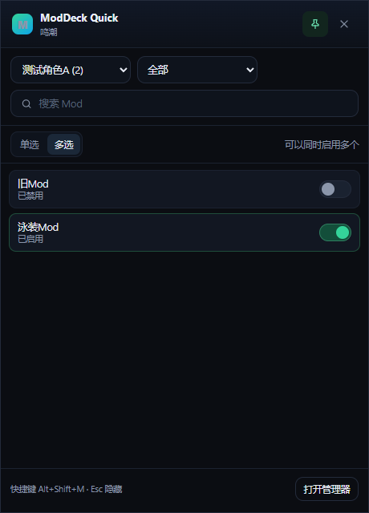

# ModDeck

[](https://github.com/yuzhoujun/ModDeck/actions/workflows/ci.yml)
[](https://github.com/yuzhoujun/ModDeck/releases/latest)
[](LICENSE)
[](#五环境要求与兼容说明)
[](https://www.typescriptlang.org/)
[](https://www.electronjs.org/)
[](docs/ARCHITECTURE.md)

面向 3DMigoto / XXMI 系游戏的开源、现代、本地优先（Local-First）Windows Mod 管理器与游戏内全功能快捷悬浮工作台。

ModDeck 专职接管游戏 `Mods` 目录：秒级启停、全格式智能导入、单 Mod 变体预设引擎、全角色阵容方案管理、`[Present]` 一次性帧桥接、重载行为流控与游戏内沉浸式快捷窗（Overlay）。游戏底层 Direct3D 注入与 Shader 处理严格交给 3DMigoto / XXMI，ModDeck **绝不侵入游戏内存、绝不修改游戏本体代码**，安全零封号风险。

---

## 一、下载与快速上手

- **最新正式版发布包**：前往 [GitHub Releases](https://github.com/yuzhoujun/ModDeck/releases/latest) 下载 `ModDeck-2.3.0-win-x64.zip`；
- **运行方式**：
  1. 将 ZIP 压缩包完整解压至任意目录（建议非系统只读盘，路径避免特殊符号）；
  2. **双击 `ModDeck.exe` 即可直接启动**；
  3. （备用兼容）若系统安全软件拦截了 Chromium 沙箱进程导致直接双击无窗口，可双击同目录下的 **`ModDeck.cmd`** 脚本启动（内部自动携带 `--no-sandbox` 兼容参数）；
  4. 初次打开进入「设置」，配置对应游戏的 `Mods` 或 MI 根目录。

---

## 二、软件功能总览

### 1. 现代化 Mod 库与多维分类管理

- **磁盘真实结构接管**：分类项与 Mod 直接扫描自磁盘真实结构，不强制绑定外部服务器或写死名单；
- **多维分类筛选**：支持「全部分类」、「仅角色」、「仅功能 / UI / 其他」、「仅有 Mod」及「仅无 Mod」快速过滤；
- **直观概览统计**：顶部实时统计分类项总数、角色与功能项细分占比、Mod 总量及激活启用数；
- **视觉化拖拽排序**：支持卡片一键拖拽自定义排序（顺序本机持久化存储），支持模糊搜索角色名、别名、拼音与目录名；
- **专属封面编辑器**：支持拖入任意图片，内置 1:1 视口自由平移与滚轮缩放裁剪，自动生成无损 `.preview.png`。


### 2. 批量智能导入与全格式混合拖拽

- **统一导入分割按钮（ImportDropdown）**：主界面与角色详情页全面统一为操作规范的分割按钮，支持一键选取压缩包或下拉菜单切换文件夹导入；
- **整页全格式混合拖拽（Drag & Drop）**：支持在 Windows 资源管理器中同时多选混合拖入任意数量的 `.zip` / `.7z` / `.rar` 压缩包与已解压的 Mod 文件夹；
- **离线角色智能匹配**：内置 5 大游戏全量中英/别名/拼音离线词典，自动识别解压包归属分类；
- **乱码自动修复引擎**：内置 CP437 -> GB18030 字符集无损解码引擎，自动纠正历史压缩包解压后的中文目录与乱码文件名。

### 3. 单 Mod 变体预设引擎（Mod Variant Presets）

现代 3DMigoto Mod 通常包含丰富的服装配色、配件开关与形态滑动条。
- **出厂基线快照保护**：自动深度解析作者原生 `.ini` 声明的全部持久化外观变量，生成永久内置的「默认 (初始)」预设基线，随时一键还原；
- **树状分级解耦存储**：所有预设以独立 JSON 存储于 `%APPDATA%/ModDeck/presets/{gameId}/{character}/{modName}.json`，读写微秒级响应且互不干扰；
- **现场实机快照**：在主界面或游戏内悬浮快捷窗口现场调好造型后，直接输入名称即可一键保存为新预设；
- **变体详情结构化透视**：双击或点击信息图标即可展开预设详情抽屉，人读友好化直观查看各个持久化变量设定值与对应 `.ini` 归属；
- **瞬态变量过滤（Transient Var Filter）**：智能识别并过滤非外观临时变量（如菜单开启 `$ui_menu`、页码、鼠标抓手坐标等），只比对和覆盖真正的服装与体型参数。

### 4. 全角色池方案工作台（Roster Scheme Workspace）

- **全队阵容一键批量换装**：主界面顶部「预设方案」大工作台，集中配置全队所有角色当前激活的 Mod 及其各自选定的变体预设，方案一键切换同帧全量批量生效；
- **角色池与功能/UI池双分池治理**：方案工作台自动拆分为「🎭 角色预设」与「🧩 功能/UI/世界其他」双分池，彻底避免全局 UI、大世界场景等通用 Mod 与角色皮肤混杂；
- **分池专属一键批处理与物理热键**：各分池提供「⚪ 一键全部不启用 (保持原生) [Alt+U]」与「🟢 一键选中当前使用中 [Alt+R]」，支持秒级清空或快照实机状态；
- **独立单选 (互斥) 与多选 (共存) 模式**：每个卡片独立支持单选与多选自由切换，兼顾角色皮肤模型互斥与功能 UI 多项共存需求，并根据当前激活数量智能自适应初始默认模式；
- **方案指纹防重与未保存实机改动拦截**：当选中状态与已有方案完全一致时自动禁用「存为新方案」；若检测到某 Mod 实机参数未保存，自动标亮橙色「⚠️ 当前实机 (未保存改动)」并提供二次确认或一键替换为 Default 安全入库。

### 5. 游戏内快捷操作台（Overlay）与原生按键驱动

- **游戏沉浸呼出**：默认全局快捷键 `Alt+Shift+M`（支持自定义），无需切屏即可在无边框游戏上层直接呼出；
- **Mod 状态秒级同步**：常驻监听底层的 `Mods` 与 `d3dx_user.ini`，游戏内热键调完造型外部毫秒级同步；
- **硬件级按键助手**：内置轻量原生按键助手 `ModDeckKeyHelper-v2.exe`，向游戏前台精准模拟硬件级 DirectInput/RawInput 键盘扫描码；
- **快捷侧栏现场操作台**：点击 Mod 侧栏展开变体与热键工作台，支持现场挑选预设、存为新预设及点击预设胶囊即刻换装；
- **悬浮方案抽屉与实机测速**：底部配备全角色池方案抽屉与「⏱️ 测速校准」秒表工具，无需切屏即可全队换装或精确测量重载耗时。



---

## 三、进阶功能与高级操作指南

<details open>
<summary><strong>👉 点击展开高级功能详述（帧桥接架构、重载流控、待生效队列、实机测速与刷盘机理）</strong></summary>

### 1. 变体预设切换底层生命周期：`[Present]` 一次性帧桥接与双通道机理

在 3DMigoto 原版机制中，按下 F10 重载的第 1 毫秒会先执行 `SavePersistentSettings()` 将当前旧显存中的变量强制刷入 `d3dx_user.ini`，导致外部软件直接写入配置文件的操作被 3DMigoto 瞬间覆盖回滚。

为了实现 100% 稳定的预设切换，ModDeck 打造了双通道协同换装架构：
1. **`[Present]` 一次性帧桥接（`bridge.ini`）**：
   - 切换预设时，ModDeck 在游戏 `Mods/_ModDeck_Preset_Bridge/bridge.ini` 中动态生成帧桥接配置（以 `_` 开头在分类库中自动隐身）；
   - 在 3DMigoto 完成 F10 重载跨入下一帧（`[Present]` 阶段）的微秒瞬间，直接将目标预设变量注入 Direct3D 显存并立即设置 `$md_preset_applied = 1` 自锁；
   - **效果**：确保玩家按下 F10 后实机画面**第 1 帧即刻呈现换装变身**，且自锁后绝不干扰游戏内后续按键与 GUI 调节。
2. **`d3dx_user.ini` 延迟安全补写**：
   - 重载缓冲时间结束后（由用户配置的延迟控制，默认 6s），ModDeck 自动在后台静默将预设持久化补写回 `d3dx_user.ini`，并同步清空 `bridge.ini`；
   - **效果**：实现游戏在线期间显存直通换装，并同时保全游戏关闭或崩溃后的**冷启动数据一致性**（下次进游戏依然保持该预设）。

### 2. 自动重载三向独立拆分与待生效聚合队列（Pending Preset Queue）

为了满足不同玩家对游戏流畅度的极致要求，ModDeck 将重载行为细分为三个独立维度（可在「设置 → 通用」中自由配置）：
- **切换普通 Mod 启停后自动重载**：默认关闭。避免在 Mod 库批量启用/禁用 Mod 时导致游戏画面频繁停顿卡顿；
- **切换单 Mod 变体预设后自动重载**：推荐常开。点击预设胶囊即刻驱动游戏画面换装；
- **切换全角色池方案后自动重载**：推荐常开。一键切换整套阵容即刻换装。

#### 待生效聚合队列（关闭自动重载时的多预设打包模式）：

当您关闭了预设自动重载时，ModDeck 会自动启用**待生效聚合队列**：
1. 您可以在离线或游戏中连续挑选多位角色的不同预设，无需每次停顿；
2. 每次选择都会在内存队列中以 `character:mod` 自动覆盖去重，保持最终意图；
3. 待生效预设胶囊显示**蓝色脉冲光晕**，游戏内浮动快捷窗口（Overlay）底部的「重载 F10」按钮会自动升级为高亮脉冲并带计数引导（例如 **`● 立即生效 (3)`**）；
4. 挑选完毕后，点击该按钮或按下键盘重载键，ModDeck 将所有角色的预设一次性合成至全局桥接脚本，**单次 F10 让全队所有角色同帧瞬间集体变身**！

> **⚠️ 物理键盘 F10 vs 快捷窗口重载按钮说明**：
> - 若您在待生效状态下直接按键盘物理 `F10`，游戏画面会**立即变身换装生效**（桥接配置已被 3DMigoto 读取），但 ModDeck UI 状态由于 Windows 进程隔离无法自动截获物理按键并转绿；
> - **强烈推荐**：随时按快捷键呼出快捷窗口点击底部的 **「● 立即生效 (N)」** 按钮，让画面换装、延迟写盘与 UI 绿灯完成完美闭环。

### 3. 重载缓冲同步延迟可配置（2s ~ 25s）与「⏱️ 测速校准」秒表

由于不同玩家的电脑硬件性能及启用的 Mod 数量/材质贴图大小差异巨大，3DMigoto 执行 F10 重载的实际耗时分布在 `1.1s` 到 `18s+` 不等。
- **缓冲延迟的作用**：ModDeck 需要等待 3DMigoto 编译完 Shader 并跨过 Present 帧后，才能安全补写 `d3dx_user.ini` 并清除桥接；
- **纯热生效参数**：在「设置 → 通用」中提供的「3DMigoto 重载缓冲同步延迟」滑动条为纯内存定时器，修改后无需按 F10 或重启，下一次重载即刻按新设时长计时；
- **游戏内浮动秒表测速（推荐）**：
  1. 在游戏运行中按 `Alt+Shift+M` 呼出快捷窗口，点击底部的 **「⏱️ 测速」** 按钮；
  2. 点击「开始测速」，ModDeck 将向游戏发送 F10 并毫秒级启动计时；
  3. 观察游戏画面：当重载卡顿结束、画面恢复流畅时，立即点击「停止计时」；
  4. 软件自动根据实测耗时按 `实测时间 + 1.5 秒安全余量` 一键计算并应用最适延迟，杜绝 Shader 编译未完提前清理桥接导致的预设失效。

### 4. 3DMigoto 运行时变量自动刷盘间隔（Settings Auto Save Interval）

- **原生刷盘机制**：3DMigoto 内部原生配置 `settings_auto_save_interval = 60`（每 60 秒自动将游戏内按键调整的内存外观变量刷入 `d3dx_user.ini`）；
- **自定义选项**：ModDeck 支持在设置中将其调整为 `10 秒（极速同步，推荐实机热键调造型时使用）`、`30 秒（均衡）`、`60 秒（官方默认）` 或 `-1（禁用定时）`；
- **需 F10 重载生效**：3DMigoto 仅在游戏冷启动与 F10 重载时才会重新解析 `d3dx.ini` 中的周期。在设置中修改后，可直接点击配套的 **「立即 F10 生效」** 按钮一键向游戏发送重载指令。

### 5. 3DMigoto `DISABLED_` 状态机制与文件锁智能降级

- 3DMigoto 官方通过 `exclude_recursive = DISABLED*` 忽略被禁用的 Mod 资源；
- **免退游戏热启停**：当游戏运行导致 Mod 外部文件夹被 Windows 系统进程锁定时（无法重命名目录），ModDeck 会智能降级重命名内部主 `.ini` 为 `DISABLED_*.ini`，配合 F10 重载无需退出游戏即可立刻生效。

### 6. 自定义游戏启动程序与命令行参数

- 在游戏配置面板中支持为游戏主程序自定义追加启动参数（Launch Arguments），如 `-dx11`、`-window-mode exclusive` 或其他调试参数；
- ModDeck 自身启动支持 `--no-sandbox`（跳过沙箱）、`--smoke-test`（自检测试）等调试标识。

</details>

---

## 四、游戏实测与集成状态

| 游戏平台 | 推荐 MI 注入分支 | 兼容与集成状态 | 说明 |
| :--- | :--- | :--- | :--- |
| **明日方舟：终末地** | **EFMI** | **完整实测与深度适配** | 完整验证变体预设引擎、`[Present]` 帧桥接、待生效队列、实机测速与双池方案 |
| **鸣潮** | **WWMI** | 规则兼容（待实机验证） | 采用通用 3DMigoto 树型结构与 `DISABLED_` 规范 |
| **崩坏：星穹铁道** | **SRMI** | 规则兼容（待实机验证） | 采用通用 3DMigoto 规范 |
| **绝区零** | **ZZMI** | 规则兼容（待实机验证） | 采用通用 3DMigoto 规范 |
| **异环** | **NEMI** | 规则兼容（待实机验证） | 采用通用 3DMigoto 规范 |

---

## 五、环境要求与兼容说明

- **操作系统**：Windows 10 / Windows 11 64 位（x64）；
- **运行环境**：无需安装 Python、无需全局 Node.js，发布包内已自包含完整运行环境与 native 依赖；
- **游戏窗口化要求**：快捷窗口（Overlay）置顶在游戏上层需要游戏运行于**无边框窗口模式（Borderless Windowed）**或**窗口化模式**。若开启独占全屏（Exclusive Fullscreen），Windows 窗口管理器会强制抢占置顶通道导致快捷窗无法覆顶，请将游戏调为无边框模式；
- **本地优先（Local-First）与数据隐私**：所有预设、角色封面及配置数据严格保存在本地 `%APPDATA%/ModDeck/`，离线断网完全可用，绝不上传玩家任何本地游戏资产。

---

## 六、本地数据目录结构说明

ModDeck 数据存储位于 `%APPDATA%/ModDeck/`（可在「设置 → 关于」中一键打开）：

| 文件 / 目录 | 用途说明 | 属性 |
| :--- | :--- | :--- |
| `settings.json` | 基础设置、游戏路径、快捷键与行为开关 | 核心配置 |
| `roster-presets.json` | 全角色池阵容预设方案存储 | 核心配置 |
| `presets/` | 单 Mod 变体预设分级目录（`presets/{gameId}/{character}/{mod}.json`） | 核心数据 |
| `characters.json` | 用户自定义角色别名、显示名与覆盖配置 | 核心数据 |
| `roster-cache.json` | 角色中英文词典增量缓存 | 核心数据 |
| `covers/` | 用户自定义裁切的角色头像封面（未自定义时初始为空） | 用户媒体 |
| `tmp/` | 压缩包导入解析时的临时暂存目录（导入完成后自动清理为空） | 临时缓存 |
| `logs/` | 软件启动与运行排错日志 | 诊断日志 |
| `bin/` | 绿色解压工具二进制套件 | 辅助程序 |
| `Cache / GPUCache / ...` | Chromium / Electron 渲染引擎原生硬件加速与网页缓存 | 运行时环境 |

> 💡 **备份与迁移提示**：重装系统或迁移设备时，只需整体备份复制 `%APPDATA%/ModDeck/` 目录，即可 100% 完整保留所有变体预设、全队方案、封面及个性化配置。

---

## 七、从源码构建

<details>
<summary><strong>👉 点击展开开发者编译与打包说明</strong></summary>

### 1. 开发环境准备

- Windows 10 / 11 x64
- Node.js 22+ & npm
- Git

### 2. 获取代码与依赖安装

```bash
git clone https://github.com/yuzhoujun/ModDeck.git
cd ModDeck
npm install
```

### 3. 常用开发与打包指令

```bash
# 启动热重载开发调试模式
npm run dev

# 完整静态类型检查（主进程 + Preload + 渲染层）
npm run typecheck

# 生产环境编译构建
npm run build

# 打包便携绿色免安装 ZIP 分发包
npm run package:portable
```

更多底层构建与打包机制请参阅 [docs/BUILD.md](docs/BUILD.md)。

</details>

---

## 八、版本历史与更新日志

详细版本迭代记录、功能改进与各测试修复版本说明请查阅完整更新日志：
👉 **[CHANGELOG.md](CHANGELOG.md)**

---

## 九、免责声明、版权与致谢

- **免责声明**：本项目为开源本地 Mod 资源辅助管理工具，仅操作玩家本地磁盘文件。本项目不提供任何破解、注入代码或反作弊规避能力；游戏名称、角色形象及官方资产版权均归属各自官方权利人所有。
- **开源许可**：本项目基于 **[MIT License](LICENSE)** 开源发布。
- **项目发起与维护**：由 **yuzhoujun** 发起并维护。
- **致谢**：作者此前使用的 Mod 管理器在功能和操作习惯上不太适应，于是先后委托 **大肥鱼（DeepSeek-Flash）** 与 **银弧（Gemini 4 Argon）** 协助完成软件架构设计、代码实现、疑难调试、构建与测试。
