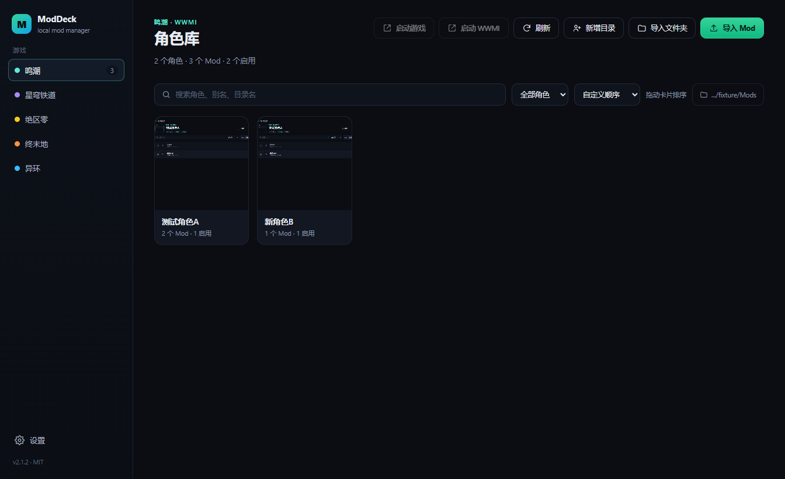
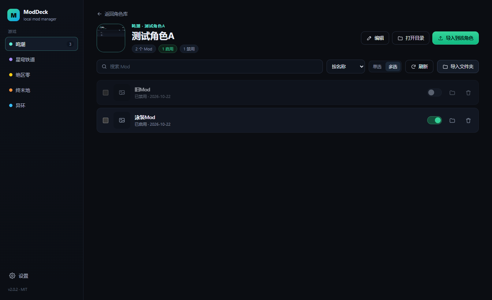

# ModDeck

[](https://github.com/yuzhoujun/ModDeck/actions/workflows/ci.yml)
[](https://github.com/yuzhoujun/ModDeck/releases/latest)
[](LICENSE)

面向 3DMigoto / XXMI 系游戏的本地 Mod 管理器。开源、离线、无账号、无服务端。

ModDeck 只做一件事：把 `Mods` 目录里的角色和 Mod 管好。注入仍然交给 XXMI / 3DMigoto，
ModDeck 不会修改游戏本体的任何文件。




## 功能

- **5 个游戏**：鸣潮、崩坏：星穹铁道、绝区零、明日方舟：终末地、异环
- **磁盘即真相**：角色 = `Mods` 下的任意文件夹，不需要内置名单
- **新角色基线**：第一次连接现有库时，当前角色会被登记为“已有”；此后新增的目录才会标“新”
- **启停**：用 `DISABLED_` 前缀重命名，失败自动重试并提示占用
- **导入**：zip / 7z / rar / 文件夹，自动识别 `Mods/<角色>/<Mod>`、`<角色>/<Mod>`、单个 `<Mod>`
- **不覆盖**：同名自动生成 `名字 (2)`；开启覆盖时先把旧目录移到 `backups/`
- **角色元数据**：显示名、别名、封面、排序保存在本机，可随游戏更新自行维护
- **搜索 / 排序 / 回收站删除**
- **完全离线**：不发起任何网络请求

## 下载与运行

V1.0 提供免安装 ZIP：[下载 Release](https://github.com/yuzhoujun/ModDeck/releases/latest)

1. 下载 `ModDeck-1.0.0-win-x64.zip`
2. 完整解压到任意目录（不要在压缩包里直接运行）
3. 双击 `Start ModDeck.cmd`（推荐）
4. 打开“设置”，为对应游戏选择 `Mods` 目录

> 某些安全软件会阻止 Electron 的 Chromium 沙箱，直接双击 `ModDeck.exe` 可能没有窗口。
> `Start ModDeck.cmd` 会用 `--no-sandbox` 启动；自建快捷方式时请带上这个参数。

系统要求：Windows 10 / 11 x64。

> 为什么不用安装器：当前构建机的安装器运行环境有问题（NSIS / Inno 都会在临时目录阶段失败），
> V1.0 先提供验证过的免安装包。安装器会在后续版本恢复。

## 从源码构建

### 环境

- Windows 10 / 11 x64
- Node.js 22 或更新（开发时使用 Node 24）
- Git
- VS Code（推荐）

### 在 VS Code 里开始

```bash
git clone https://github.com/yuzhoujun/ModDeck.git
cd ModDeck
npm install
npm run dev
```

`npm run dev` 会启动 Electron + Vite 开发窗口，改渲染层代码会自动热更新。

如果 `npm install` 下载 Electron 很慢，可以先设置镜像：

```powershell
$env:ELECTRON_MIRROR="https://npmmirror.com/mirrors/electron/"
$env:ELECTRON_CACHE="C:\path\to\electron-cache"
npm install
```

### 常用命令

| 命令 | 作用 |
| --- | --- |
| `npm run dev` | 开发模式 |
| `npm run build` | 构建到 `out/` |
| `npm run typecheck` | 主进程 + 渲染层类型检查 |
| `npm run smoke` | 无头冒烟测试（假库，输出截图与 `smoke-result.json`） |
| `npm run scan:report` | 只读扫描报告（需准备 `.scan-data/settings.json`） |
| `npm run dist` | electron-builder 打包（NSIS + portable） |
| `npm run package:portable` | 构建并生成带 README / 启动器的免安装 ZIP |

### 打包免安装 ZIP

```bash
npm run package:portable
```

脚本会构建、打包 `release/win-unpacked/`、放入 `README.txt` 和 `Start ModDeck.cmd`，
再生成 `release/ModDeck-<version>-win-x64.zip` 并打印 SHA256。需要本机安装 7-Zip。

只打包目录：

```bash
npm run build
npx electron-builder --dir
```

### 打包 Inno Setup 安装器（可选）

安装 [Inno Setup 6](https://jrsoftware.org/isinfo.php)，然后：

```powershell
& "$env:LOCALAPPDATA\Programs\Inno Setup 6\ISCC.exe" installer\ModDeck.iss
```

产物在 `release/ModDeck-<version>-Setup.exe`。

## 数据位置

| 路径 | 内容 |
| --- | --- |
| `%APPDATA%/ModDeck/settings.json` | 游戏路径、导入选项、排序 |
| `%APPDATA%/ModDeck/characters.json` | 角色显示名、别名、封面、排序、基线 |
| `%APPDATA%/ModDeck/covers/` | 用户设置的封面副本 |
| `%APPDATA%/ModDeck/backups/` | 覆盖导入前的备份 |
| `%APPDATA%/ModDeck/logs/` | 错误日志 |

ModDeck 不写游戏目录；只对用户选择的 `Mods` 目录做启停、导入、删除操作，删除走系统回收站。

## 设计

- **不依赖在线名单**：角色和 Mod 来自目录扫描。
- **元数据外置**：别名、封面、排序放在用户目录，游戏出新角色不需要等客户端更新。
- **安全边界**：`contextIsolation`、路径段校验、图片走受限自定义协议、删除走回收站。

更多实现细节见 [docs/ARCHITECTURE.md](docs/ARCHITECTURE.md)。

## 已知限制（V1.0）

- 仅 Windows x64。
- 不包含游戏启动器、游戏内 overlay、热键编辑、市场或账号功能。
- 安装器暂未提供，使用免安装 ZIP。
- 只读验证过 38 个角色 / 61 个 Mod / 约 25.5 GB 的真实库。

## 参与开发

欢迎提 Issue 和 PR。提交前请至少跑：

```bash
npm run typecheck
npm run build
npm run smoke
```

## 许可

MIT。ModDeck 是 clean-room 实现，不包含任何第三方管理器的代码、图标、文案或游戏素材。
游戏名称、角色名称及相关素材版权归各自权利人所有。
