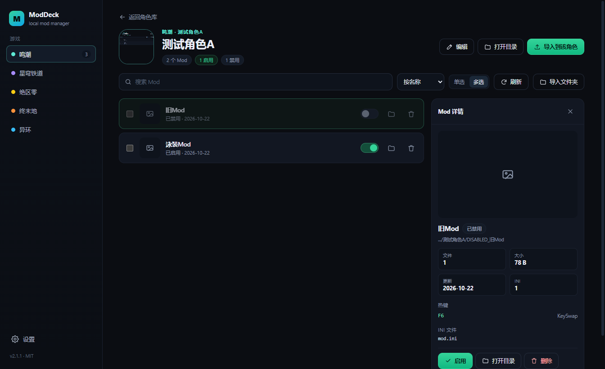
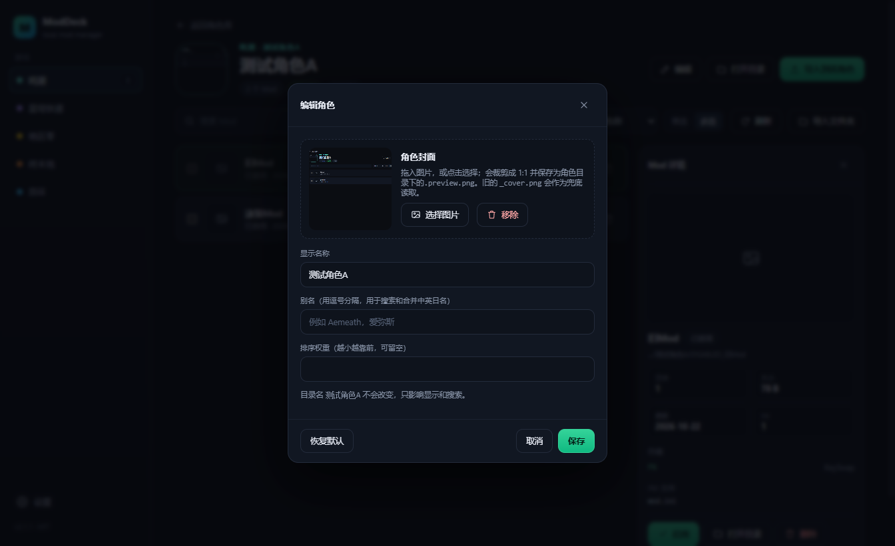
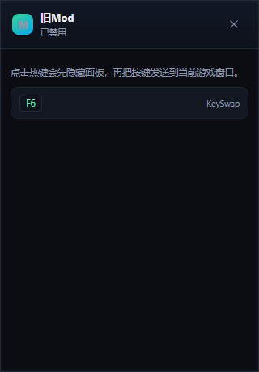

# ModDeck

[](https://github.com/yuzhoujun/ModDeck/actions/workflows/ci.yml)
[](https://github.com/yuzhoujun/ModDeck/releases/latest)
[](LICENSE)

面向 3DMigoto / XXMI 系游戏的本地 Mod 管理器。开源、离线、无账号、无服务端。

ModDeck 只做一件事：把 `Mods` 目录里的角色和 Mod 管好。注入仍然交给 XXMI / 3DMigoto，
ModDeck 不会修改游戏本体的任何文件。







## 功能

- **5 个游戏**：鸣潮、崩坏：星穹铁道、绝区零、明日方舟：终末地、异环
- **磁盘即真相**：角色 = `Mods` 下的任意文件夹，不需要内置名单
- **新角色基线**：第一次连接现有库时，当前角色会被登记为“已有”；此后新增的目录才会标“新”
- **角色筛选**：全部 / 仅有 Mod / 仅无 Mod；`.` 和 `_` 开头的目录自动隐藏
- **角色封面**：优先读取 `.preview.png/jpg/webp`，兼容旧的 `_cover.*`；编辑时可拖入/选择图片并裁剪 1:1 保存
- **新增目录**：角色库可以直接创建新角色或“功能 Mod”目录
- **自定义排序**：角色卡片、Mod 列表都可以拖动排序，顺序保存在本机
- **单选 / 多选**：角色页和快捷窗口都能切换；单选时启用一个会自动关闭其他，多选支持批量启停
- **快捷启动**：顶部直接启动游戏或 XXMI / 加载器，不做注入
- **快捷窗口**：全局快捷键（默认 `Alt+Shift+M`，可改）呼出紧凑 Mod 开关面板，可置顶/取消置顶
- **热键侧栏**：点击快捷窗口里的 Mod，在旁边展开 ini 热键列表；点击热键会先隐藏面板再发送到游戏
- **Mod 详情**：点击 Mod 在右侧查看预览、大小、文件数、ini、热键，并可启停/打开/删除
- **启停**：用 `DISABLED_` 前缀重命名，失败自动重试并提示占用
- **导入**：zip / 7z / rar / 文件夹，自动识别 `Mods/<角色>/<Mod>`、`<角色>/<Mod>`、单个 `<Mod>`
- **不覆盖**：同名自动生成 `名字 (2)`；开启覆盖时先把旧目录移到 `backups/`
- **角色元数据**：显示名、别名、封面、排序保存在本机，可随游戏更新自行维护
- **设置分页**：通用（快捷键/数据）、配置（游戏路径）、导入、关于
- **完全离线**：不发起任何网络请求

## 下载与运行

V2.1 提供免安装 ZIP（GitHub Release 只发 1.0.0 / 2.0.0 / 2.1.0 这类大版本）：

1. 下载 `ModDeck-2.1.0-win-x64.zip`
2. 完整解压到任意目录（不要在压缩包里直接运行）
3. 双击 `ModDeck.cmd` 启动
4. 打开“设置”，为对应游戏选择 EFMI 根目录或 `Mods` 目录

> 某些安全软件会阻止 Electron 的 Chromium 沙箱，所以启动入口统一使用 `ModDeck.cmd`，
> 它内部会带 `--no-sandbox`。

系统要求：Windows 10 / 11 x64。

## 从源码构建

### 环境

- Windows 10 / 11 x64
- Node.js 22 或更新（开发时使用 Node 24）
- Git
- VS Code（推荐）
- 7-Zip（打包免安装 ZIP）

### 在 VS Code 里开始

```bash
git clone https://github.com/yuzhoujun/ModDeck.git
cd ModDeck
npm install
npm run dev
```

`npm run dev` 会启动 Electron + Vite 开发窗口，改渲染层代码会自动热更新。

如果 `npm install` 下载 Electron 很慢：

```powershell
$env:ELECTRON_MIRROR="https://npmmirror.com/mirrors/electron/"
$env:ELECTRON_CACHE="C:\path\to\temp\electron-cache"
npm install
```

### 常用命令

| 命令 | 作用 |
| --- | --- |
| `npm run dev` | 开发模式 |
| `npm run build` | 构建到 `out/` |
| `npm run typecheck` | 主进程 + 渲染层类型检查 |
| `npm run smoke` | 无头冒烟测试（夹具在 `temp/`，不会碰真实 Mods） |
| `npm run scan:report` | 只读扫描报告 |
| `npm run package:portable` | 构建免安装 ZIP（入口 `ModDeck.cmd`） |

发布构建的完整步骤、产物结构和注意事项见 **[docs/BUILD.md](docs/BUILD.md)**。

- **免安装版（唯一发布方式）**：`npm run package:portable` →
  `release/ModDeck-<version>-win-x64.zip`，解压后双击 `ModDeck.cmd`。
- 安装版已放弃：Inno/NSIS 安装器在当前 Windows 安全环境下无法创建临时目录（Error 5），
  这不是安装器内容的问题；不再提供 `.exe` 安装包。

## 数据位置

正常情况下使用 `%APPDATA%/ModDeck/`；如果 AppData 被安全软件拦截，ModDeck 会自动改用
exe 同目录的 `ModDeck-data/`。

| 路径 | 内容 |
| --- | --- |
| `settings.json` | 游戏路径、启动参数、导入选项、筛选/排序、自定义顺序、快捷键 |
| `characters.json` | 角色显示名、别名、封面、排序、基线 |
| `covers/` | 旧版通过对话框设置的封面副本 |
| `Mods/<角色>/.preview.png` | 新编辑流程保存的默认封面；旧的 `_cover.*` 兼容读取 |
| `backups/` | 覆盖导入前的备份 |
| `logs/` | 运行日志 |

> 升级：先打开“设置 → 关于”确认新版本实际使用的数据目录，再把旧目录里的
> `settings.json`、`characters.json`、`covers/` 复制过去。旧版如果用的是 exe 旁的
> `ModDeck-data`，新版本能写 AppData 时会改用 `%APPDATA%\ModDeck`，不会自动读取旧文件夹。

ModDeck 不写游戏目录；只对用户选择的 `Mods` 目录做启停、导入、删除操作，删除走系统回收站。

## 设计

- **不依赖在线名单**：角色和 Mod 来自目录扫描。
- **元数据外置**：别名、封面、排序放在用户目录，游戏出新角色不需要等客户端更新。
- **安全边界**：`contextIsolation`、路径段校验、图片走受限自定义协议、删除走回收站。

更多实现细节见 [docs/ARCHITECTURE.md](docs/ARCHITECTURE.md)。

## 更新日志

版本历史、本地小版本内容与“只在大版本发 Release”的规则见 [CHANGELOG.md](CHANGELOG.md)。

## 兼容性

- 选择 EFMI 根目录（例如 `.../XXMI/XXMI/EFMI`）或它的 `Mods` 目录都可以，
  ModDeck 会统一落到 `Mods`。
- EFMI 自带的 `d3dx.ini` 默认包含 `include_recursive = Mods` 和
  `exclude_recursive = DISABLED*`，所以 `DISABLED_` 前缀是 EFMI/3DMigoto 的加载规则，
  不依赖某个外部管理器；如果该配置被改掉，禁用前缀会失效。

## 已知限制（V2.1.0）

- 仅 Windows x64。
- 不包含 Mod 注入、游戏内 overlay、市场或账号功能；启动游戏/XXMI 只是调用外部程序。
- 不提供 `.exe` 安装器；使用免安装 ZIP + `ModDeck.cmd`。
- 只读验证过 38 个角色 / 61 个 Mod / 约 25.5 GB 的真实库。

## 参与开发

欢迎提 Issue 和 PR。提交前请至少跑：

```bash
npm run typecheck
npm run build
npm run smoke
```

## 许可

MIT。ModDeck 是 clean-room 实现，不包含任何第三方管理器的代码、图标、文案或游戏素材。
游戏名称、角色名称及相关素材版权归各自权利人所有。

