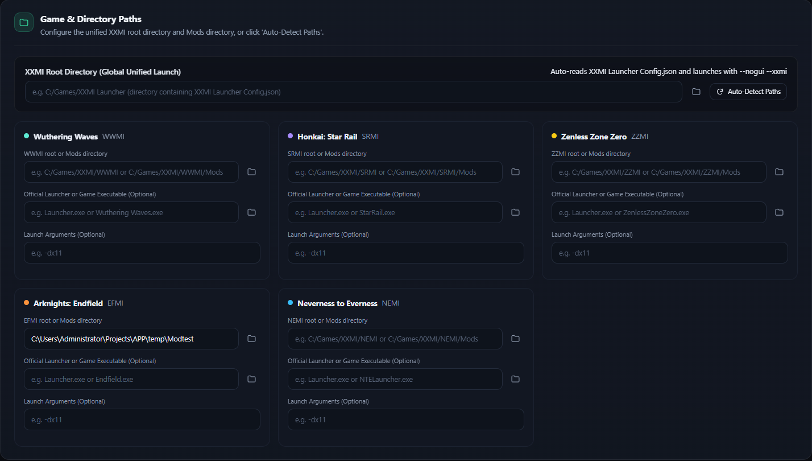
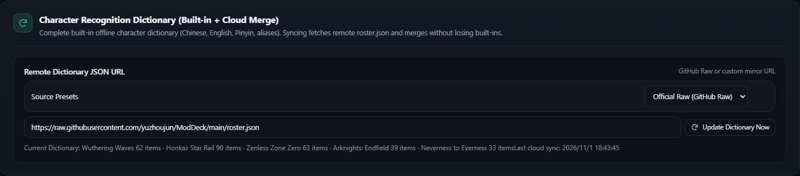
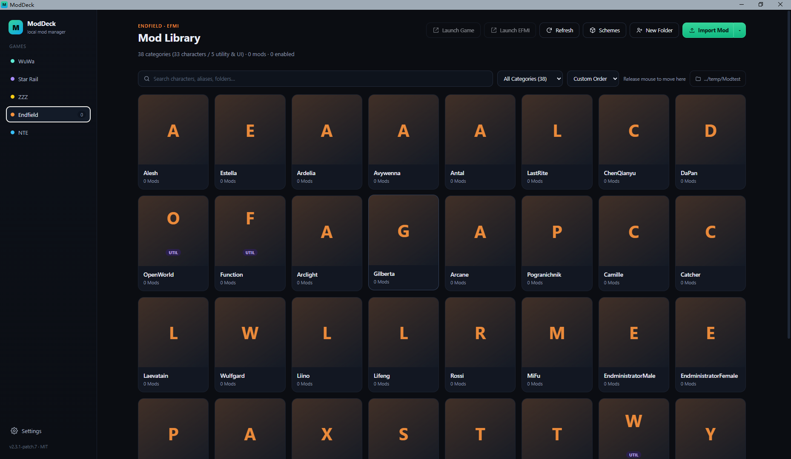
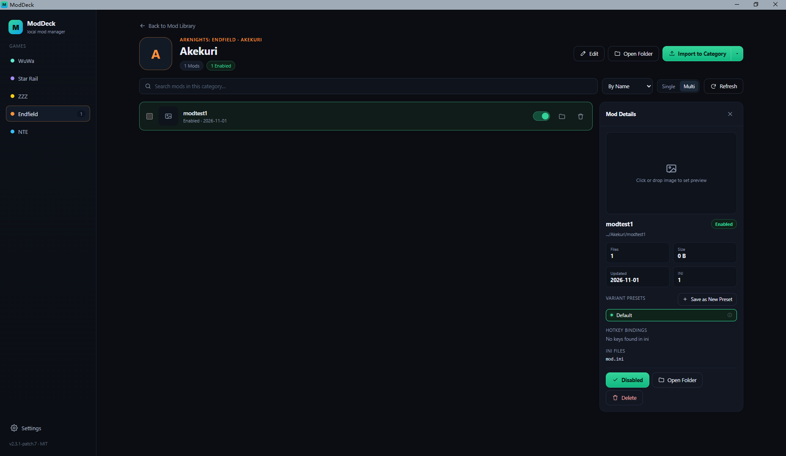
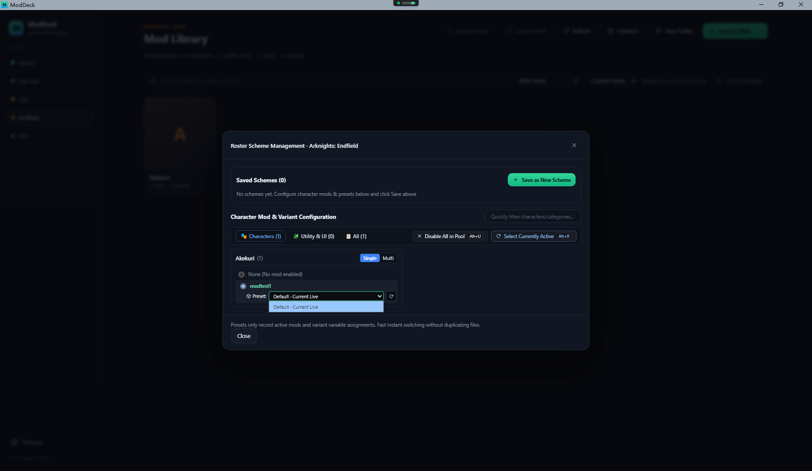
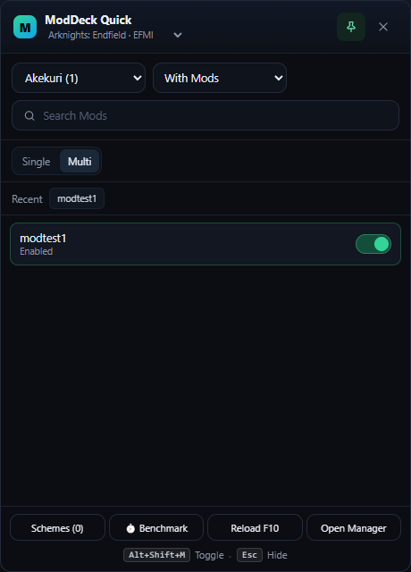

# ModDeck

[](#5-system-requirements--compatibility)
[](docs/ARCHITECTURE.md)
[](docs/ARCHITECTURE.md)
[](LICENSE)
[](https://github.com/yuzhoujun/ModDeck/actions/workflows/ci.yml)
[](https://github.com/yuzhoujun/ModDeck/releases/latest)

[简体中文文档 (README.zh-CN.md)](README.zh-CN.md) | [v2 -> v3 Migration Guide](docs/MIGRATION_V2_TO_V3.md)

An open-source, Local-First Windows mod manager and in-game floating overlay built with Tauri 2 and Rust for 3DMigoto / XXMI games.

ModDeck manages game `Mods` directories directly on disk: toggling (`DISABLED_`), batch archive imports, single-mod variant presets, whole-roster outfit schemes, one-frame `[Present]` bridge injection, reload flow control, static INI diagnostics, conflict auditing, and a topmost quick overlay. Direct3D hooking and shader rendering remain solely within 3DMigoto / XXMI—ModDeck **never injects DLLs, hooks game memory, or modifies game executables**.

---

## 1. Download & Quick Start

> [!IMPORTANT]
> **Prerequisites & Scope**:
> ModDeck manages mods and presets; **it does not bundle or teach initial setup of XXMI or game-specific model importers**. Please obtain XXMI from [SpectrumQT/XXMI-Launcher](https://github.com/SpectrumQT/XXMI-Launcher) first. Basic familiarity with 3DMigoto/XXMI directory layouts is expected.

1. Download the portable archive (`ModDeck-<version>-win-x64.zip`) from [GitHub Releases](https://github.com/yuzhoujun/ModDeck/releases/latest).
2. Extract the full ZIP into a writable folder (avoid launching inside the archive preview or system-protected read-only folders).
3. Double-click `ModDeck.exe` to launch:
   - Requires Microsoft Edge WebView2 Runtime (pre-installed on Windows 11 and updated Windows 10; if missing on stripped Windows builds, ModDeck prompts on startup and offers Microsoft's Evergreen installer page).
4. Open **Settings -> Paths** to configure each game's `Mods` or XXMI root folder and optional launcher/game executables (supports auto-detection and manual selection):

   

5. Optional **Remote Character Dictionary**: in **Settings -> Import**, configure character dictionary JSON URLs or mirrors to update bilingual official names, aliases, and Pinyin mappings:

   

Upgrading from ModDeck v2 (Electron)? See [docs/MIGRATION_V2_TO_V3.md](docs/MIGRATION_V2_TO_V3.md) — your existing `%APPDATA%\ModDeck\` settings, presets, covers, and schemes carry over automatically.

---

## 2. Core Features

### 1. Mod Library & Category Management

- **Disk as Source of Truth**: Scans categories and mods directly from your `Mods` directory (`DISABLED_` prefix toggling with file-lock fallback onto internal `.ini` files while a game is running).
- **Filtering & Search**: Filter by All, Characters Only, Utility / UI / Other, With Mods, or Without Mods; search across localized names, aliases, Pinyin, and folder names.
- **Drag-and-Drop Ordering & Cover Editor**: Customize category/mod ordering locally and crop 1:1 `.preview.png` category covers via pan/zoom preview.
- **Native Folder Watcher**: Monitors the active `Mods` tree and `d3dx_user.ini` for external additions, deletions, recycle-bin restores, and in-game F10 writes.



### 2. Batch Archive Import & Upgrade Target Selection

- **Full-Page Drag & Drop / File Picker**: Supports `.zip`, `.7z`, `.rar`, and unpacked folders simultaneously, including streaming decompression, multi-charset header auto-repair (UTF-8 / CP437 / GB18030 / Big5 / Shift-JIS / EUC-KR), and interactive password prompts for encrypted archives.
- **Editable Target Names & Explicit Upgrade Targets**: In the import preview modal, rename destination folder names inline or hand-pick an existing mod (including disabled `DISABLED_*` folders) to back up and replace safely—preventing version suffixes or tags such as `efmittl` from leaving stale duplicates or overwriting the wrong mod.
- **Offline & Remote Character Matching**: Auto-assigns candidates using built-in + remote-synced character dictionaries across 5 built-in games plus custom games.

### 3. Single-Mod Variant Presets Engine

> [!NOTE]
> **Engine Scope**:
> ModDeck's Variant Presets Engine targets **discrete cosmetic toggle variables declared with `persist`** (e.g., colorways, hairstyles, clothing pieces). Non-persisted control variables or continuous floating-point calculations computed dynamically inside complex `[CommandList]` blocks may not capture reliably in `d3dx_user.ini` snapshots; INI Static Diagnostics highlights non-persisted control variables directly in Mod Details.

- **Factory Baseline (`Default`)**: Parses author `.ini` initial persistent values to maintain a built-in `Default` snapshot.
- **Live In-Game Capture & F10 Sync**: Displays live `d3dx_user.ini` write status (`gameRunning`, mtime, auto-save interval) and offers async `F10 & Save` synchronization with stale-detection feedback (`pending-queue`, `f10-timeout`, `unsynced-game-running`).
- **Variable Ignore Rules**: Exclude transient state variables globally (exact match, wildcard, or regex) or per-mod via `.moddeck-ignore`.



### 4. Dual-Pool Roster Schemes Workspace

- **Character + Utility Separation**: Splits configurations into **Character Presets** and **Utility / UI / World** pools so global UI mods do not interfere with character skins.
- **Per-Card Single / Multi Mode & Fingerprinting**: Choose mutually exclusive or multi-mod combinations per category, batch enable or reset per pool, detect unsaved live modifications, and block duplicate saves.



### 5. In-Game Quick Overlay, Hotkey Sidecar & Native Input

- **Global Summon & Tray Mode**: Summon `ModDeck Quick` with `Alt+\` (customizable; validated against `reloadHotkey`), close to system tray when `closeBehavior` is `minimize`, and dismiss overlays with `Escape`.
- **Adjacent `overlay-detail` Sidecar**: Click any mod card in Quick Overlay to inspect presets and INI hotkeys (`hotkey` + `back`), with `type = hold`, modifier-only combos (`CTRL ALT`), and mouse buttons (`VK_LBUTTON`) labeled cleanly to prevent accidental single-tap triggers.
- **Hardware Scan-Code Injection**: Built directly into the Rust backend (`SendInput` with extended keys, OEM punctuation, `VK_*`, hex virtual keys, and `no_modifiers` release handling) without spawning external key-helper executables.
- **Game & Loader Launch**: Launches `XXMI Launcher.exe --nogui --xxmi <CODE>`, custom loaders, or official game launchers (including quoted `launchArgs` and Win32 `ShellExecuteW` UAC elevation fallback).



### 6. Preset / Scheme Sharing, Static INI Audit & Config Migration

- **Import/Export Sharing**: Share single-mod presets (`.moddeck-preset.json`) or full roster schemes (`.moddeck-scheme.json`) with automated local matching and missing variant reconstruction (`ImportSchemeModal`).
- **Static INI Diagnostics & Conflict Audit**: Scans `[Key*]`/`[CommandList]` persist declarations, per-character Shader/Texture Hash overlaps, duplicate FX preloads (`RabbitFX`, `CrossIBClassifier.ini`, `KatFXMatcap`), `[ShaderRegex]`, `[ShaderOverride]` risk levels, and cross-mod Hash collisions with one-click disable, `ShaderCache` cleanup, and `.txt` export.
- **Storage Manager & Full Bundle Migration (`.moddeck-bundle`)**: Tracks storage usage, restores/prunes mod overwrite backups (including `DISABLED_*` backups), and exports/imports complete backups of settings, custom games, covers, presets, and schemes.

### 7. Localization & Custom Games

- **Built-in Bilingual UI (`zh-CN` / `en-US`)**: Instant language switching (`Auto`, `zh-CN`, `en-US`) backed by 921 aligned dictionary keys (`scripts/i18n.mjs`), canonical English character names, and automatic discovery of drop-in `.json` packs under `languages/` next to `ModDeck.exe` or inside `%APPDATA%\ModDeck\languages\`.
- **Custom Games & Sidebar Controls**: Add, edit, or hide custom 3DMigoto/XXMI games with per-locale names and optional "Configured Games Only" filtering.

---

## 3. Architecture & Reload Mechanics (Summary)

1. **One-Frame Bridge + Safe Deferred Flush**: Applying presets writes active variables into `Mods/_ModDeck_Preset_Bridge/bridge.ini` (`[Present]` self-lock `$md_preset_applied = 1`), triggers `F10`, waits for `postReloadSyncDelay` (configurable in `Settings -> Advanced` or calibrated via the floating Stopwatch Benchmark), persists values to `d3dx_user.ini`, and clears `bridge.ini`.
2. **Pending Preset Queue**: When auto-reload is off, changes accumulate in memory per `game:character:mod` until you click **Apply Now (N)** or trigger F10.
3. **Process Monitoring**: Native Win32 process snapshots (`CreateToolhelp32Snapshot`) drive live game status badges without shell `tasklist` overhead.

For full subsystem details, see [docs/ARCHITECTURE.md](docs/ARCHITECTURE.md).

---

## 4. Game Compatibility & Verification Status

> [!IMPORTANT]
> **Live Verification Scope**:
> Extensive live gameplay testing (including variant capture, `[Present]` bridge injection, benchmark calibration, and full launcher integration) has been conducted primarily on **Arknights: Endfield (EFMI)**.
> Built-in entries for **Wuthering Waves (WWMI)**, **Honkai: Star Rail (SRMI)**, **Zenless Zone Zero (ZZMI)**, and **Neverness to Everness (NEMI)** implement the same 3DMigoto/XXMI directory and `.ini` rules, pending broader community testing in live sessions.

| Game | MI Branch | Status | Notes |
| --- | --- | --- | --- |
| **Arknights: Endfield** | **EFMI** | Verified in live sessions | Primary test environment across import, presets, overlay, and launcher flows |
| **Wuthering Waves** | **WWMI** | Migrated (pending live test) | Standard XXMI/3DMigoto directory and `.ini` handling |
| **Honkai: Star Rail** | **SRMI** | Migrated (pending live test) | Standard XXMI/3DMigoto directory and `.ini` handling |
| **Zenless Zone Zero** | **ZZMI** | Migrated (pending live test) | Standard XXMI/3DMigoto directory and `.ini` handling |
| **Neverness to Everness** | **NEMI** | Migrated (pending live test) | Standard XXMI/3DMigoto directory and `.ini` handling |

---

## 5. System Requirements & Compatibility

- **OS**: Windows 10 / Windows 11 64-bit (`x64`).
- **WebView2**: Microsoft Edge WebView2 Runtime (built into Windows 11 and modern Windows 10; checked at startup).
- **Local-First & Offline**: All settings, covers, presets, and backups reside in `%APPDATA%\ModDeck\` (falling back to `ModDeck-data\` beside `ModDeck.exe` if AppData is restricted). Zero telemetry or external uploads.

---

## 6. Building from Source

```bash
git clone https://github.com/yuzhoujun/ModDeck.git
cd ModDeck
npm install

npm run typecheck
npm run i18n:check
cargo test --manifest-path src-tauri/Cargo.toml
npm run package:portable
```

See [docs/BUILD.md](docs/BUILD.md) for prerequisites (Node.js 24, Rust stable + MSVC Build Tools) and release workflow details.

---

## 7. Changelog

- Current development log: [CHANGELOG.md](CHANGELOG.md) ([简体中文](CHANGELOG.zh-CN.md))
- v1.0.0 - v2.5.0 Electron archive: [docs/CHANGELOG_V2_ARCHIVE.md](docs/CHANGELOG_V2_ARCHIVE.md)

---

## 8. Security, Disclaimer & Contributing

- **Non-Invasive File Tool**: ModDeck only reads/writes mod folders, `d3dx_user.ini`, `d3dx.ini`, and `bridge.ini` text configurations and dispatches foreground scan-code keystrokes. It never injects DLLs or modifies game binaries.
- **Third-Party Mods**: Users are responsible for the quality, safety, and compliance of third-party mods and 3DMigoto/XXMI usage under each game's policies.
- **Issues-Only Contribution Policy**: Bug reports, feature requests, and character dictionary additions are welcome via [GitHub Issues](https://github.com/yuzhoujun/ModDeck/issues). External code PRs are not accepted; see [.github/CONTRIBUTING.md](.github/CONTRIBUTING.md).
- **License**: [MIT License](LICENSE) — initiated and maintained by **yuzhoujun**, with technical assistance from DeepSeek and Gemini.
