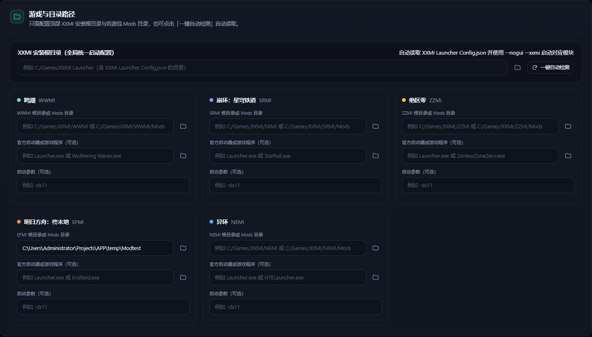
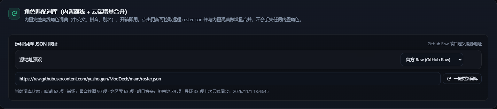
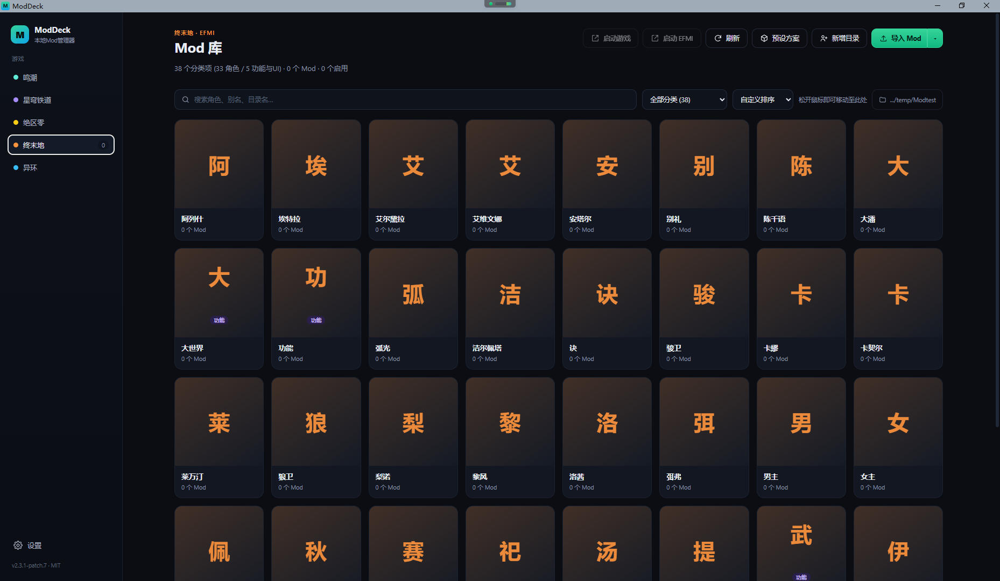
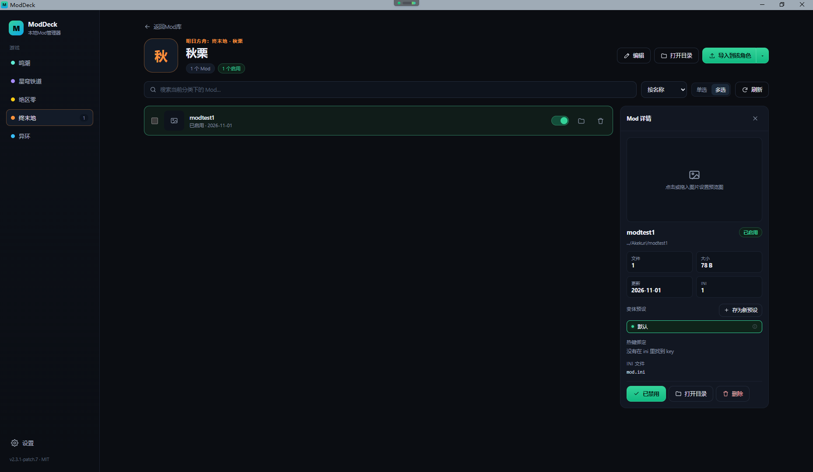
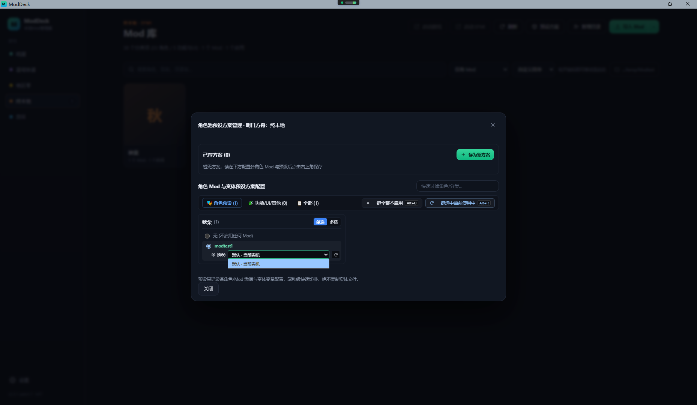
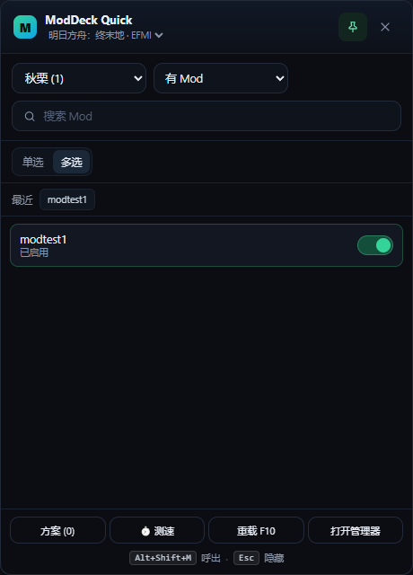

# ModDeck

[](#5-环境要求与兼容说明)
[](docs/ARCHITECTURE.zh-CN.md)
[](docs/ARCHITECTURE.zh-CN.md)
[](LICENSE)
[](https://github.com/yuzhoujun/ModDeck/actions/workflows/ci.yml)
[](https://github.com/yuzhoujun/ModDeck/releases/latest)

[English Documentation (README.md)](README.md) | [v2 -> v3 无损迁移指南](docs/MIGRATION_V2_TO_V3.zh-CN.md) | [后续路线图 (Roadmap)](docs/ROADMAP.zh-CN.md)

面向 3DMigoto / XXMI 系游戏的开源、本地优先（Local-First）Windows Mod 管理器与游戏内快捷悬浮工作台（基于 Tauri 2 + Rust 原生后端与系统 WebView2）。

ModDeck 专职在磁盘与配置层面管理游戏 `Mods` 目录：`DISABLED_` 启停、多格式压缩包批量导入、单 Mod 变体预设引擎、全角色池搭配方案、`[Present]` 一次性帧桥接、重载流控、INI 静态诊断、冲突审计与游戏内快捷浮窗。底层 Direct3D 拦截与着色器渲染完全由 3DMigoto / XXMI 负责，ModDeck **绝不注入 DLL、不读写游戏内存、不修改游戏本体可执行文件**。

---

## 1. 下载与快速上手

> [!IMPORTANT]
> **前置要求说明**：
> 本软件为 Mod 资源管理与快捷操作台，**不内置 XXMI 或各游戏 MI 的安装包及基础配置教程**。请先前往 [SpectrumQT/XXMI-Launcher](https://github.com/SpectrumQT/XXMI-Launcher) 完成对应游戏 MI 环境搭建。

1. 前往 [GitHub Releases](https://github.com/yuzhoujun/ModDeck/releases/latest) 下载 **Windows 安装包**（`ModDeck-<version>-win-x64-setup.exe`）或 **免安装便携包**（`ModDeck-<version>-win-x64.zip`）。
2. 运行安装向导（支持标准卸载并可勾选是否清理用户数据，后续覆盖升级可依据注册表自动定位安装目录），或将便携 ZIP 完整解压到任意可写入文件夹（切勿在压缩包预览内直接双击运行）。
3. 启动 `ModDeck`（`ModDeck.exe`）：
   - 依赖 Windows 系统内置的 Microsoft Edge WebView2 运行库（Win11 与常见 Win10 已自带；NSIS 安装包缺失时可自动安装，便携版启动时亦会弹出微软官方引导提示）。
   - 从 v2.x 免安装版升级时会自动无损沿用 `%APPDATA%\ModDeck\`，并在发现旧版 Electron 缓存/废旧文件时提供一键规范清理入口（位于启动横幅或「设置 -> 存储与备份」）。
4. 首次进入 **设置 -> 路径** 配置游戏 `Mods` / XXMI 根目录及可选启动器路径（支持自动探测与手动选取）：

   

5. 可选 **远端角色词库同步**：在 **设置 -> 导入** 配置词库 JSON 地址或镜像源，一键更新各游戏中英文官方译名、别名与拼音：

   

若从 v2（Electron 版）升级，请参阅 [docs/MIGRATION_V2_TO_V3.zh-CN.md](docs/MIGRATION_V2_TO_V3.zh-CN.md)：`%APPDATA%\ModDeck\` 下原有设置、预设、方案与封面可直接无损继承。

---

## 2. 核心功能总览

### 1. Mod 库管理与多维分类

- **磁盘即真相**：直接扫描 `Mods` 目录物理结构，`DISABLED_` 前缀启停，游戏运行中被锁定目录时自动降级重命名内部主 `.ini` 实现热启停。
- **筛选、排序与封面裁切**：支持全部 / 仅角色 / 功能 UI / 有 Mod / 无 Mod 过滤，支持拼音与中英文搜索、卡片拖拽排序与 1:1 `.preview.png` 裁切编辑。
- **原生文件系统监听**：自动感知外部新增、删除、回收站恢复与 `d3dx_user.ini` 游戏内写盘刷新界面。



### 2. 批量智能导入与升级目标手选

- **整页全格式拖拽与选择器**：同时支持 `.zip` / `.7z` / `.rar` 与已解压文件夹，流式异步解压、自动修复乱码编码（UTF-8 / CP437 / GB18030 / Big5 / Shift-JIS / EUC-KR），并支持加密压缩包弹窗输入密码。
- **目标名称编辑与覆盖升级目标手选**：导入预览窗支持按条目微调目标文件夹名，或从目标角色现有 Mod 列表中手选需替换的旧版（兼容已禁用 `DISABLED_*` 目录并自动留存备份至历史记录），避免因版本号或 `efmittl` 等用途后缀不同而重复残留或误覆盖。
- **离线 + 云端角色匹配**：内置 5 款预设游戏与自定义游戏的角色匹配字典。

### 3. 单 Mod 变体预设引擎

> [!NOTE]
> **引擎边界说明**：
> 本引擎主要针对声明了 `persist` 的离散外观开关（如配色、发型、配件切换）。对未声明 `persist` 的控制变量或依赖 `[CommandList]` 复杂浮点动态计算/连续滑条的变量，可能无法完整捕获快照；Mod 详情页中的 **INI 静态诊断** 会标出未声明 `persist` 的控制变量供参考。

- **出厂基线保护**：自动提取作者原生 `.ini` 中 `persist` 变量默认值生成内置「默认」预设。
- **实机同步与异步 `F10 并保存`**：实时展示 `d3dx_user.ini` 最近写盘时间与游戏运行状态，支持触发 F10 并轮询写盘完成后自动查重落盘（含 `pending-queue`、`f10-timeout`、`unsynced-game-running` 判据）。
- **变量捕获过滤**：支持在设置页配置精确名称 / 通配符 / 正则忽略规则，以及读取 Mod 目录内 `.moddeck-ignore`。



### 4. 全角色池双分池搭配方案

- **角色池与功能/UI 池隔离**：自动分为「角色预设」与「功能 / UI / 世界其他」双池管理，避免全局 UI Mod 干扰角色皮肤配置。
- **独立单选/多选与防重校验**：支持按分类独立切换单选（互斥）/ 多选（共存）、分池一键开关、未保存实机改动拦截以及方案指纹去重。



### 5. 游戏内快捷悬浮窗、热键侧栏与原生按键

- **全局快捷键与托盘驻留**：默认 `Alt+\` 呼出/隐藏悬浮窗（支持自定义并与 `reloadHotkey` 做冲突校验），关闭行为设为「最小化到托盘」时驻留双语系统托盘，支持 `Esc` 逐层关闭浮窗。
- **紧邻副窗 `overlay-detail`**：点击浮窗内任意 Mod 自动在主浮窗左/右侧展开预设与热键侧栏；支持 `.ini` 内 `key`/`back` 提取与标点键（`,` / `.` / `/` 等）及 `no_modifiers` 发送，并对 `type = hold`、纯修饰键（如 `CTRL ALT`）和鼠标交互键（`VK_LBUTTON`）显示轻量标签与提示，防止误点报错或卡键。
- **内置 Rust 原生输入驱动与启动器联动**：通过 Win32 `SendInput` 直接向游戏前台发送按键扫描码（不再依赖外部辅助 EXE）；支持拉起 `XXMI Launcher.exe --nogui --xxmi <CODE>`、自定义 Loader、官方启动器（含带引号参数与 `ShellExecuteW` UAC 提权回退）。



### 6. 分享导入导出、冲突审计与备份迁移

- **单 Mod 预设与全队方案分享**：支持 `.moddeck-preset.json` 与 `.moddeck-scheme.json` 导出/导入及缺失变体重建（`ImportSchemeModal`）。
- **冲突审计与缓存清理**：检测同角色 Hash 重叠、重复或互斥 FX 前置插件（`RabbitFX` / `CrossIBClassifier.ini` / `KatFXMatcap`）、`[ShaderRegex]`、`[ShaderOverride]` 风险分级与跨 Mod Hash 碰撞，支持一键禁用冲突 Mod、清空 `ShaderCache` 与导出 `.txt` 报告。
- **存储管理与全量配置迁移（`.moddeck-bundle`）**：统计配置/封面/备份/日志占用，还原或清理 Mod 覆盖备份，并支持一键打包或跨机迁移全部配置、封面、预设与方案。

### 7. 双语界面、外挂语言包与自定义游戏

- **内置简中 / 英文实时热切换**：内建 921 条 100% 对齐词条（`Auto` / `zh-CN` / `en-US`），支持将社区语言包放入 `ModDeck.exe` 同级 `languages/` 或 `%APPDATA%\ModDeck\languages\` 热加载。
- **自定义游戏与侧栏治理**：支持新增自定义游戏、配置多语言名称与「仅显示已配置 Mods 目录的游戏」过滤。

---

## 3. 核心架构与重载机理简述

1. **`[Present]` 一帧桥接与后置写盘**：切换预设时先写入 `Mods/_ModDeck_Preset_Bridge/bridge.ini` 并通过 `$md_preset_applied = 1` 在 Next Present 帧注入显存，待设定的 `postReloadSyncDelay` 结束后写入 `d3dx_user.ini` 并清理桥接文件；可用悬浮「⏱️ 测速」工具校准延迟。
2. **待生效聚合队列**：关闭自动重载时，连续预设/启停操作会在队列去重聚合，最终按一次「立即生效 (N)」或 F10 同帧集体生效。
3. **原生进程监控**：通过 Win32 `CreateToolhelp32Snapshot` 识别游戏运行状态，零子进程开销。

详见 [docs/ARCHITECTURE.zh-CN.md](docs/ARCHITECTURE.zh-CN.md)。

---

## 4. 游戏实测与集成状态

> [!IMPORTANT]
> **实机测试说明**：
> 当前仅有 **《明日方舟：终末地》（EFMI）** 在作者真实游戏环境中完成了全链路深度实测验证。**《鸣潮》（WWMI）、《崩坏：星穹铁道》（SRMI）、《绝区零》（ZZMI）、《异环》（NEMI）** 基于相同 3DMigoto/XXMI 目录与 INI 规则完成代码迁移，仍待更多实机反馈。

| 游戏 | 推荐 MI 分支 | 状态 | 说明 |
| --- | --- | --- | --- |
| **明日方舟：终末地** | **EFMI** | 已深度实测验证 | 主力测试平台，完整验证导入、预设、浮窗、启动器与帧桥接链路 |
| **鸣潮** | **WWMI** | 规则已迁移（待广泛实机验证） | 同构 3DMigoto/XXMI 目录与 INI 解析逻辑 |
| **崩坏：星穹铁道** | **SRMI** | 规则已迁移（待广泛实机验证） | 同构 3DMigoto/XXMI 目录与 INI 解析逻辑 |
| **绝区零** | **ZZMI** | 规则已迁移（待广泛实机验证） | 同构 3DMigoto/XXMI 目录与 INI 逻辑 |
| **异环** | **NEMI** | 规则已迁移（待广泛实机验证） | 同构 3DMigoto/XXMI 目录与 INI 逻辑 |

---

## 5. 环境要求与兼容说明

- **操作系统**：Windows 10 / Windows 11 64 位（x64）。
- **WebView2**：依赖系统 Microsoft Edge WebView2 Runtime（启动时自动检测，缺失时提示引导安装）。
- **本地优先（Local-First）**：数据保存于 `%APPDATA%\ModDeck\`（受限时回退至程序同级 `ModDeck-data\`），全程纯本地离线可用，零遥测上传。

---

## 6. 从源码构建

```bash
git clone https://github.com/yuzhoujun/ModDeck.git
cd ModDeck
npm install

npm run typecheck
npm run i18n:check
cargo test --manifest-path src-tauri/Cargo.toml
npm run package:portable
```

环境前置与发版规则详见 [docs/BUILD.zh-CN.md](docs/BUILD.zh-CN.md)。

---

## 7. 更新日志

- v3.x 主干更新日志：[CHANGELOG.zh-CN.md](CHANGELOG.zh-CN.md)（[English](CHANGELOG.md)）
- v1.0.0 ~ v2.5.0（Electron 时期）历史归档：[docs/CHANGELOG_V2_ARCHIVE.md](docs/CHANGELOG_V2_ARCHIVE.md)

---

## 8. 安全性、免责声明与协作规则

- **纯外部文件管理**：ModDeck 仅操作磁盘 Mod 目录、`d3dx_user.ini`、`d3dx.ini`、`bridge.ini` 文本及发送前台扫描码按键，不注入 DLL 也不修改游戏二进制。
- **第三方 Mod 风险**：第三方 Mod、Shader 及 XXMI 使用风险需由玩家自行依据各游戏厂商条款评估承担。
- **Issues-Only 协作模式**：欢迎通过 [GitHub Issues](https://github.com/yuzhoujun/ModDeck/issues) 反馈 Bug、建议与角色词库条目；本项目不接收外部代码 PR（详见 [.github/CONTRIBUTING.md](.github/CONTRIBUTING.md)）。
- **开源协议**：基于 **[MIT License](LICENSE)** 开源，由 **yuzhoujun** 发起并维护，开发过程中获 DeepSeek 与 Gemini 协作支持。
