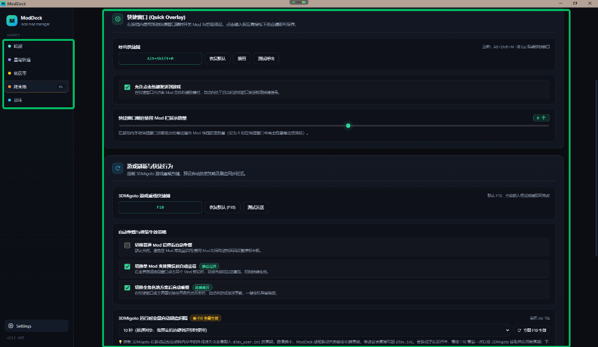
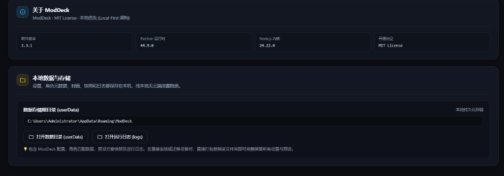
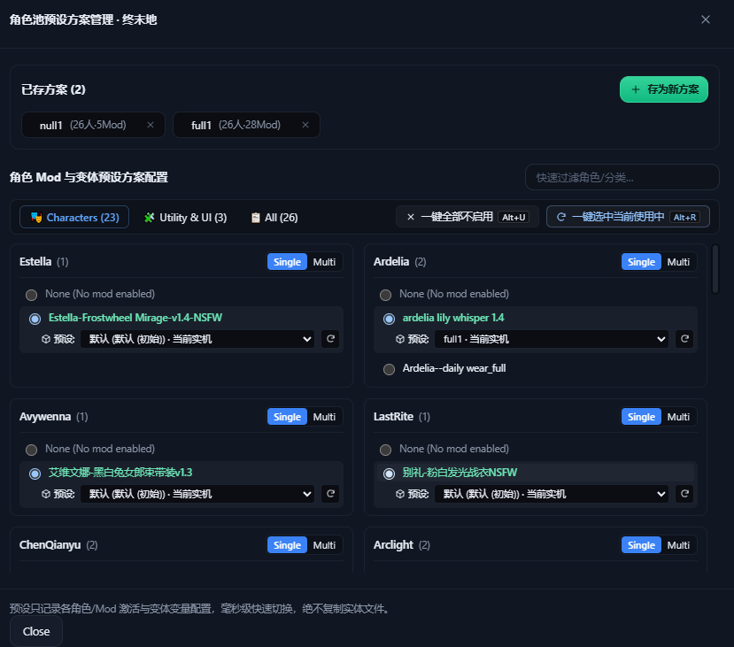
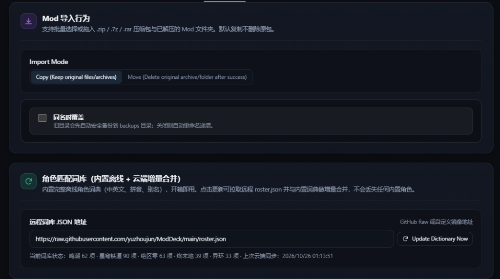

# ModDeck

[](#5-system-requirements--compatibility)
[](docs/ARCHITECTURE.md)
[](docs/ARCHITECTURE.md)
[](LICENSE)
[](https://github.com/yuzhoujun/ModDeck/actions/workflows/ci.yml)
[](https://github.com/yuzhoujun/ModDeck/releases/latest)

[简体中文文档 (README.md)](README.md)

An open-source, modern, Local-First Windows mod manager and immersive in-game overlay designed for 3DMigoto and XXMI based games.

ModDeck exclusively manages game `Mods` directories: sub-second toggling, all-format intelligent archive imports, a standalone Mod Variant Presets Engine, whole-team Roster Scheme management, zero-lag `[Present]` one-frame bridge switching, reload flow control, and an immersive in-game floating overlay. Direct3D rendering and shader compilation are handled natively by 3DMigoto / XXMI. ModDeck **never injects code into game processes and never alters game executables**, ensuring total safety and zero ban risk.

---

## 1. Download & Quick Start

- **Latest Release**: Go to [GitHub Releases](https://github.com/yuzhoujun/ModDeck/releases/latest) to download `ModDeck-2.3.0-win-x64.zip` (or your locally built portable release);
- **How to Run**:
  1. Extract the ZIP package to any writable folder (non-system drive recommended; avoid special characters in path);
  2. **Double-click `ModDeck.exe` to launch directly**;
  3. (Compatibility Fallback) If third-party antivirus blocks the Chromium sandbox causing no window to display, launch via **`ModDeck.cmd`** in the same folder (automatically passes `--no-sandbox`);
  4. On first launch, open "Settings" to configure your game's `Mods` or MI root folder.

---

## 2. Features Overview

### 1. Modern Mod Library & Multi-Dimensional Category Management

- **Disk as Source of Truth**: Categories and mods are scanned directly from physical disk structure; never hardcoded to external servers or remote registries;
- **Multi-Dimensional Filtering**: Instantly filter by "All", "Characters Only", "Utility / UI / World", "With Mods", or "Without Mods";
- **Intuitive Metrics**: Real-time header metrics displaying total category count, character vs utility breakdown, total mods, and active mod count;
- **Visual Drag & Drop Sorting**: Drag cards to customize rank orders (stored locally); supports fuzzy search by character name, English alias, Pinyin, or folder name;
- **Built-in Cover Cropper**: Drag & drop any image, with 1:1 viewport translation and mouse-wheel zoom, saving lossless `.preview.png`.



### 2. Batch Intelligent Import & Mixed Drag-and-Drop

- **Unified Import Split Button (`ImportDropdown`)**: Clean split button across main library and character views, supporting one-click archive pick or dropdown folder selection;
- **Full-Page Mixed Drag & Drop**: Select and drop multiple `.zip`, `.7z`, `.rar` archives and extracted folders simultaneously directly into the window;
- **Offline Character Dictionary Matching**: Built-in multi-lingual offline dictionary covering 5 major games for automatic archive recognition;
- **Encoding Auto-Repair Engine**: Built-in CP437 -> GB18030 lossless decoding engine, automatically correcting garbled directory names in legacy archives.

### 3. Standalone Mod Variant Presets Engine

Modern 3DMigoto mods often feature extensive color variations, toggleable accessories, and morph sliders.

- **Factory Default Baseline Protection**: Automatically parses author's native `.ini` persistent variables, permanently embedding a "Default" baseline snapshot to restore anytime;
- **Decoupled Tree Storage**: Stored as standalone JSON files under `%APPDATA%/ModDeck/presets/{gameId}/{character}/{modName}.json`, ensuring microsecond lookup and full isolation;
- **Live In-Game Snapshot**: Fine-tune your outfit in-game or in the overlay, enter a name, and save as a standalone preset with one click;
- **Structured Variables Inspector**: Double-click or click the info icon to inspect active `.ini` files and persistent variables;
- **Transient Variable Filtering**: Automatically ignores non-cosmetic variables (such as menu toggles `$ui_menu`, page numbers, cursor coordinates) so only true outfit parameters are compared and applied.

### 4. Roster Scheme Workspace

- **Whole-Team Batch Outfit Switching**: Configure active mods and variant presets across your entire roster in one master workspace; switch the entire team in a single frame;
- **Dual-Pool Governance**: Split into "🎭 Character Presets" and "🧩 Utility / UI / World" pools, preventing general utility mods from interfering with character outfits;
- **Pool-Level Batch Actions & Hotkeys**: Each pool provides "⚪ Keep Native [Alt+U]" and "🟢 Use Current Live [Alt+R]" for sub-second roster resets;
- **Independent Single vs Multi Mode**: Every card supports independent single-choice (mutual exclusion) or multi-choice (coexistence) toggles;
- **Fingerprint Deduplication & Dirty State Safety**: Disables duplicate saves when selection matches an existing scheme; alerts with "⚠️ Current Live (Unsaved changes)" when live parameters have unsaved tweaks.



### 5. In-Game Floating Overlay & Native Key Helper

- **Immersive In-Game Summoning**: Press `Alt+Shift+M` (customizable) to summon the overlay over borderless windowed games without Alt+Tab;
- **Sub-Second Mod State Sync**: Continuously listens to disk and `d3dx_user.ini` for real-time external synchronization;
- **Hardware-Level Key Helper**: Built-in lightweight `ModDeckKeyHelper-v2.exe` simulates hardware-level DirectInput/RawInput scan codes directly to game foreground;
- **Live Variant Sidecar Panel**: Click any mod to expand variant presets, live snapshots, and hotkey triggers;
- **Floating Stopwatch Benchmark**: Built-in "⏱️ Benchmark" tool measures reload duration on-screen without leaving the game.



### 6. Multi-Language System & Extensible i18n

- **Instant Bilingual Switching**: Built-in `zh-CN` (Simplified Chinese) and `en-US` (English) translation dictionaries with 100% structural parity (over **660+** keys); supports instant hot-reloading without restart;
- **Canonical English Character Names**: Full offline character database with `canonicalEnName` for international game releases; seamless search by English names, Chinese, or folder names;
- **Standalone `languages/` Directory**: Independent `languages/` folder separated from Chromium system `.pak` files; drop any community translation (e.g. `ja-JP.json`, `ko-KR.json`) to load dynamically;
- **Developer Localization Toolchain**: Built-in `scripts/i18n.mjs` with automated Chinese code extraction (`npm run i18n:extract`), one-click incremental merge and TODO placeholders sync (`npm run i18n:extract:apply`), parity and caller verification (`npm run i18n:check`), and structural synchronization (`npm run i18n:sync`).



---

## 3. Advanced Features & Architecture Guide

<details open>
<summary><strong>👉 Click to expand advanced architecture (Frame Bridge, Reload Flow, Pending Queue, Benchmark & Flushing)</strong></summary>

### 1. Variant Preset Lifecycle: `[Present]` One-Frame Bridge & Dual-Channel Persistence

Under vanilla 3DMigoto, pressing F10 reload immediately triggers `SavePersistentSettings()` in the first millisecond, overwriting `d3dx_user.ini` with old memory variables. Direct file writes by external managers are immediately wiped out.

ModDeck solves this race condition via a dual-channel architecture:
1. **`[Present]` One-Frame Bridge (`bridge.ini`)**:
   - On preset switch, ModDeck generates a temporary bridge configuration in `Mods/_ModDeck_Preset_Bridge/bridge.ini` (prefixed with `_` to remain hidden);
   - As 3DMigoto completes F10 reload and steps into the next frame (`[Present]` phase), target variables are injected into Direct3D memory and self-locked via `$md_preset_applied = 1`;
   - **Result**: Visual outfit switches on the **very first rendered frame**, without interfering with subsequent in-game GUI or hotkeys.
2. **Delayed Safe Persistence to `d3dx_user.ini`**:
   - Once reload buffer delay finishes (default 6s, configurable), ModDeck flushes the preset into `d3dx_user.ini` in the background and clears `bridge.ini`;
   - **Result**: Immediate live visual switching plus **100% cold-boot consistency** when relaunching games.

### 2. Three-Way Independent Auto-Reload & Pending Preset Queue

To cater to different hardware performance levels, auto-reload behavior is split into 3 independent switches (configured under Settings -> Advanced):
- **Auto-reload on regular Mod toggle**: Default OFF. Prevents repetitive stuttering when enabling/disabling multiple mods;
- **Auto-reload on single Mod variant preset**: Recommended ON. Click any preset capsule to swap outfits immediately;
- **Auto-reload on full roster scheme**: Recommended ON. Instantly reload and apply complete team outfits.

#### Pending Preset Queue (Batch Mode When Auto-Reload is Disabled):

When preset auto-reload is turned off, ModDeck activates the **Pending Preset Queue**:
1. Select presets across multiple characters without waiting for reload stutters;
2. Each selection deduplicates in memory by `character:mod`, keeping your final choice;
3. Pending preset capsules glow with a **blue pulse effect**, and the overlay reload button highlights with a counter (e.g., **`● Apply Now (3)`**);
4. Click Apply Now or press F10 to synthesize all presets into a single bridge script, **swapping all character outfits in a single frame**!

> **⚠️ Physical F10 vs In-Game Overlay Reload Button**:
> - Pressing physical `F10` on your keyboard will reload the game immediately (3DMigoto reads the bridge), but ModDeck UI cannot capture global physical keystrokes due to Windows process isolation;
> - **Recommended**: Summon the overlay (`Alt+Shift+M`) and click **「● Apply Now (N)」** for complete UI state synchronization.

### 3. Configurable Reload Buffer Delay (2s - 25s) & Stopwatch Benchmark

Because hardware specs and mod sizes vary drastically, 3DMigoto F10 reload times range from `1.1s` to over `18s`.
- **Purpose of Buffer Delay**: ModDeck waits for 3DMigoto shader compilation to pass Present frames before safely writing persistence and clearing bridges;
- **Hot-Reloadable Parameter**: The slider under Settings -> Advanced is an in-memory timer; changes take effect immediately without restarting;
- **Floating Stopwatch Benchmark (Recommended)**:
  1. In-game, press `Alt+Shift+M` to summon the overlay and click **「⏱️ Benchmark」**;
  2. Click "Start Benchmark": ModDeck sends F10 and starts millisecond timing;
  3. Observe game screen: As soon as reload stutter ends and gameplay returns to smooth, click "Stop Timer";
  4. Automatically calculates and applies `Measured Duration + 1.5s Safety Margin`.

### 4. 3DMigoto Runtime Auto Save Interval

- **Native Mechanism**: 3DMigoto natively uses `settings_auto_save_interval = 60` (flushing memory variables to `d3dx_user.ini` every 60s);
- **Custom Options**: Configurable in ModDeck to `10s (Fast, recommended when tuning outfits)`, `30s (Balanced)`, `60s (Default)`, or `-1 (Disabled)`;
- **Requires F10 to Apply**: 3DMigoto parses this setting only on startup or F10 reload. Click the adjacent **「Apply Interval Now」** button to reload immediately.

### 5. `DISABLED_` Mechanism & File Lock Fallback

- 3DMigoto ignores disabled mods using `exclude_recursive = DISABLED*` in `d3dx.ini`;
- **Zero-Restart Live Toggle**: When game locks mod folders on Windows (preventing directory renames), ModDeck intelligently falls back to renaming internal `.ini` files to `DISABLED_*.ini`.

### 6. Custom Game Launchers & Arguments

- Configure custom launch arguments (such as `-dx11`, `-window-mode exclusive`) for your game executables;
- ModDeck CLI flags: `--no-sandbox` (skip Chromium sandbox), `--smoke-test` (headless self-test).

</details>

---

## 4. Game Compatibility & Integration Status

| Game Platform | Recommended MI Branch | Compatibility Status | Notes |
| :--- | :--- | :--- | :--- |
| **Arknights: Endfield** | **EFMI** | **Fully Verified & Integrated** | Full support for variant engine, `[Present]` bridge, pending queue, benchmark & dual-pool schemes |
| **Wuthering Waves** | **WWMI** | Rule Compatible (Testing Pending) | Standard 3DMigoto tree structure and `DISABLED_` convention |
| **Honkai: Star Rail** | **SRMI** | Rule Compatible (Testing Pending) | Standard 3DMigoto specification |
| **Zenless Zone Zero** | **ZZMI** | Rule Compatible (Testing Pending) | Standard 3DMigoto specification |
| **Neverness to Everness** | **NEMI** | Rule Compatible (Testing Pending) | Standard 3DMigoto specification |

---

## 5. System Requirements & Compatibility

- **Operating System**: Windows 10 / Windows 11 64-bit (x64);
- **Runtime Environment**: Standalone green release with all native dependencies self-contained (no Python or system Node.js required);
- **Windowed Mode Requirement**: To display the overlay over gameplay, games must run in **Borderless Windowed** or **Windowed Mode**. Exclusive Fullscreen prevents Windows topmost window composition;
- **Local-First & Data Privacy**: All presets, covers, and configs are stored strictly in local `%APPDATA%/ModDeck/`. Completely functional offline with zero cloud telemetry.

---

## 6. Local Data Directory Structure

Data is stored in `%APPDATA%/ModDeck/` (openable via Settings -> About):

| File / Folder | Purpose | Nature |
| :--- | :--- | :--- |
| `settings.json` | Core settings, paths, hotkeys, and switches | Core Config |
| `roster-presets.json` | Whole-team roster scheme definitions | Core Config |
| `presets/` | Standalone mod variant presets (`presets/{gameId}/{character}/{mod}.json`) | Core Data |
| `characters.json` | Custom character aliases, display names, and baseline data | Core Data |
| `roster-cache.json` | Multilingual offline character dictionary cache | Core Data |
| `covers/` | Custom cropped character portrait covers | User Media |
| `languages/` | External community language packs directory | i18n Extension |
| `tmp/` | Temporary staging during archive extraction (auto-cleaned) | Cache |
| `logs/` | Startup and runtime diagnostic logs | Diagnostic |
| `bin/` | Portable extraction binaries | Utilities |
| `Cache / GPUCache / ...` | Chromium / Electron hardware acceleration cache | Runtime |

> 💡 **Backup & Migration**: To migrate or backup your setup, simply copy the `%APPDATA%/ModDeck/` directory to retain all variant presets, schemes, covers, and preferences.

---

## 7. Building from Source

<details>
<summary><strong>👉 Click to expand developer build & packaging instructions</strong></summary>

### 1. Prerequisites

- Windows 10 / 11 x64
- Node.js 22+ (Node 24 recommended) & npm
- Git

### 2. Clone & Install Dependencies

```bash
git clone https://github.com/yuzhoujun/ModDeck.git
cd ModDeck
npm install
```

### 3. Build & Development Commands

```bash
# Start hot-reload development mode
npm run dev

# Full TypeScript static type check (Main + Preload + Renderer)
npm run typecheck

# Verify i18n key parity, code t/tMain calls, and scan raw Chinese strings
npm run i18n:check

# Deeply extract untranslated strings from code into structured JSON tree & details
npm run i18n:extract

# One-click incremental merge into zh-CN and sync TODO placeholders to en-US (git diff ready)
npm run i18n:extract:apply

# Recursively synchronize all locale structures to base zh-CN (660+ keys)
npm run i18n:sync

# Production build (outputs to out/)
npm run build

# Package portable standalone distribution ZIP (outputs release/ModDeck-<version>-win-x64.zip)
npm run package:portable
```

For more build internals, see [docs/BUILD.md](docs/BUILD.md).

</details>

---

## 8. Version History & Changelog

For detailed release notes and change logs:
👉 **[CHANGELOG.md](CHANGELOG.md)**

---

## 9. Disclaimer, License & Acknowledgments

- **Disclaimer**: ModDeck is an open-source local mod file management tool that operates solely on local user storage. It provides no hacking, memory injection, or anti-cheat bypassing capabilities. All game titles, character assets, and trademarks belong to their respective copyright holders.
- **License**: Licensed under the **[MIT License](LICENSE)**.
- **Project Creator & Maintainer**: Initiated and maintained by **yuzhoujun**.
- **Acknowledgments**: Built with development and architectural assistance from **DeepSeek-Flash (大肥鱼)** and **Gemini 4 Argon (银弧)**.
