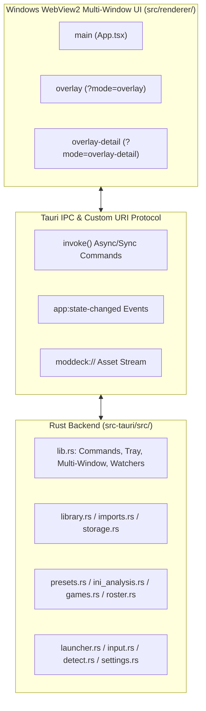
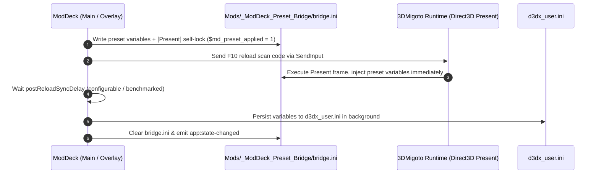

# ModDeck Architecture & Subsystem Design

[简体中文 (ARCHITECTURE.zh-CN.md)](ARCHITECTURE.zh-CN.md)

## 1. Design Philosophy

1. **Non-Invasive Asset Management**:
   - ModDeck strictly manages folders, `.preview.*` covers, and `.ini` parameter text configurations on disk (`d3dx_user.ini`, `d3dx.ini`, `bridge.ini`).
   - Direct3D rendering, shader replacement, and runtime hooks stay exclusively inside 3DMigoto / XXMI. ModDeck never injects DLLs or modifies game binaries.
2. **Disk as Source of Truth**:
   - Character categories and mods are scanned directly from disk without requiring external servers or hardcoded rosters.
3. **Local-First & Offline-Capable**:
   - Settings, presets, roster schemes, cropped covers, and overwrite backups reside locally on the user's machine with zero telemetry.

---

## 2. Game `Mods` Directory Layout

```text
Mods/
├── CharacterA/                     # First-level category directory
│   ├── SampleMod/                  # Enabled mod folder
│   │   ├── mod.ini                 # 3DMigoto config & persistent variables
│   │   └── preview.png             # Optional mod preview image
│   └── DISABLED_OtherMod/          # Disabled mod (DISABLED_ prefix)
├── CharacterB/
├── Characters/                     # Optional nested container supported by scanner
└── _ModDeck_Preset_Bridge/         # Runtime one-frame bridge (hidden via leading _)
    └── bridge.ini                  # [Present] injection script
```

- **Enable / Disable**: Renames the mod folder with or without `DISABLED_` (relying on `exclude_recursive = DISABLED*` in `d3dx.ini`). When Windows locks a folder while a game runs, ModDeck falls back to toggling internal `.ini` filenames (`DISABLED_*.ini`).
- **Hidden Prefixes**: Directories starting with `.` or `_` are excluded from mod scanning.

---

## 3. Local User Data Layout

All user data is stored under `%APPDATA%\ModDeck\` (falling back to `ModDeck-data\` beside `ModDeck.exe`):

| File / Directory | Role |
| --- | --- |
| `settings.json` | Game paths, UI/advanced switches, custom games, hotkeys, ignore rules |
| `roster-presets.json` | Dual-pool roster scheme definitions |
| `presets/{gameId}/{character}/{mod}.json` | Decoupled per-mod variant presets |
| `characters.json` | Custom display names, aliases, sort order, visibility metadata |
| `roster-cache.json` | Remote-synced character dictionary cache |
| `covers/{game}/{hash}.png` | Cropped category covers |
| `backups/` | Mod overwrite backups and pre-import config snapshots |
| `languages/` | User/community locale JSON packs |
| `tmp/` | Staging dirs for archive extraction & HTML5 drop uploads (auto-cleaned) |
| `logs/tauri-crash.log` | Startup/runtime crash diagnostics |

---

## 4. Tauri 2 + Rust Process Architecture



### Rust Backend Modules (`src-tauri/src/`)

- `lib.rs` / `main.rs`: Application lifecycle, WebView2 Registry preflight check, `EBWebView-recovery` ACL fallback, single-instance guard, system tray (`tray-icon`), multi-window orchestration (`main`, `overlay`, `overlay-detail`), `moddeck://` asset protocol, native Windows directory/file watchers (`FindFirstChangeNotificationW` on `Mods` and `d3dx_user.ini`), and debounced async F10/post-sync timers.
- `library.rs`: Disk scanning, `DISABLED_` toggling with file-lock `.ini` fallback, cover discovery, mod details, and section-aware INI hotkey parsing (`type = hold` / `modifier-hold` / `mouse` classification).
- `imports.rs`: Streaming extraction (`zip`, `sevenz-rust`, `unrar`), CP437/GB18030/Big5/Shift-JIS/EUC-KR encoding repair, encrypted archive password sessions, target folder renaming, and explicit upgrade overwrite + `DISABLED_` sibling backups.
- `presets.rs` & `ini_analysis.rs`: Variant snapshot capture, `Default` baseline synthesis, `ModDeckPresetBridge.ini` `[Present]` injection, `PendingQueueState`, static persist diagnostics, and cross-mod Hash/FX conflict auditing.
- `launcher.rs` & `input.rs` & `detect.rs`: XXMI Launcher (`--nogui --xxmi`), official game launcher + quoted `launchArgs` + `ShellExecuteW` UAC fallback, Win32 `CreateToolhelp32Snapshot` running-process detection, Win32 `SendInput` scan-code injection, and auto-path detection (`winreg` + XXMI Launcher Config).
- `storage.rs`: Storage breakdown, backup restore/pruning, Recycle Bin deletion (`trash`), and `.moddeck-bundle` archive export/import.

---

## 5. `[Present]` Frame Bridge Lifecycle



---

## 6. Security & Safety Boundaries

- **Path Confinement**: Every filesystem operation enforces safe single-segment sanitization and canonical ancestor containment (`is_inside`) to prevent directory traversal (`..`) outside `Mods` or `%APPDATA%\ModDeck\`.
- **Asset Protocol Allowlist**: `moddeck://` only reads allowed image extensions located inside `%APPDATA%\ModDeck\covers\` or configured `Mods` roots.
- **Recycle Bin Safety**: Deletions move folders via `trash` to the Windows Recycle Bin instead of unlinking permanently.
