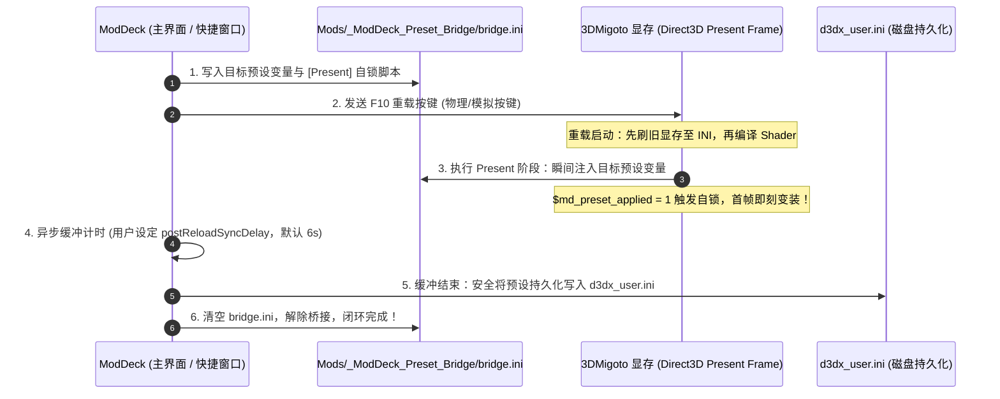

# ModDeck 架构设计与系统原理

## 一、目标与设计哲学

### 核心定位

ModDeck 是面向 3DMigoto / XXMI 系游戏的开源、现代、本地优先（Local-First）Windows Mod 管理器与游戏内全功能快捷悬浮工作台。

### 设计原则

1. **专注资源治理，绝不侵入游戏底层**：
   - ModDeck 专职接管游戏 `Mods` 目录的资源组织、变体持久化与外观配置调度；
   - 游戏底层的 Direct3D 注入、Shader 替换与显存加载完全交由 3DMigoto / XXMI 处理；
   - ModDeck **不向游戏进程注入代码、不修改游戏本体客户端与可执行文件**，保证零封号风险。
2. **磁盘即真相（Disk as Source of Truth）**：
   - 角色与 Mod 状态直接扫描自磁盘物理结构，不强制绑定外部服务器或写死名单；
   - 游戏版本更新或新增角色时，只要磁盘目录建立即可自动识别，客户端无需等待发版。
3. **本地优先与纯离线可用（Local-First & Privacy）**：
   - 预设快照、方案数据、裁切封面与配置均严格保存在本地设备；
   - 离线断网完全可用，绝不上传玩家任何本地资产或游戏数据。

---

## 二、目录约定与物理状态模型

### 1. 游戏 Mods 目录规范

```text
Mods/
  角色目录A/
    某个Mod/
      mod.ini
      preview.png
    DISABLED_另一个Mod/         ← 目录级禁用状态
  角色目录B/
  Characters/                   ← 兼容历史嵌套容器
  _ModDeck_Preset_Bridge/       ← 运行时一次性帧桥接（以 _ 开头在库中隐身）
    bridge.ini
```

- **角色/分类判定**：`Mods/` 下的任意一级子目录（包括 `Characters/` 容器内的子目录均完全兼容）；
- **Mod 目录判定**：角色目录下的文件夹；
- **启用与禁用状态**：
  - **默认机制（目录重命名）**：启用为原名，禁用为加前缀 `DISABLED_`；
  - **3DMigoto 规则**：依赖 `d3dx.ini` 中的 `exclude_recursive = DISABLED*` 规则在引擎层忽略禁用项；
  - **免退游戏热启停降级机制**：若游戏处于运行中导致文件夹被 Windows 系统进程锁定（无法重命名目录），ModDeck 自动降级为将内部主 `.ini` 重命名为 `DISABLED_*.ini`，配合 F10 重载无需退出游戏即可立即生效；
- **隐身过滤**：以 `.` 或 `_` 开头的目录不参与角色与 Mod 扫描（例如 `_efmi_ini_tools`、`_ModDeck_Preset_Bridge`）。

---

## 三、本地数据持久化架构

软件所有运行时配置与用户数据均统一保存在 `%APPDATA%/ModDeck/`：

| 文件 / 目录 | 内容与职责 | 存储特性 |
| :--- | :--- | :--- |
| `settings.json` | 游戏路径、通用/高级开关、快捷键与 UI 偏好 | 核心配置 |
| `roster-presets.json` | 全角色池阵容预设方案存储 | 核心配置 |
| `presets/{gameId}/{character}/{mod}.json` | 单 Mod 变体预设树状存储 | 核心数据（微秒级解耦寻址） |
| `characters.json` | 角色自定义显示名、别名、排序、隐藏与基线时间 | 核心数据 |
| `roster-cache.json` | 角色离线词库增量缓存与云端同步缓存 | 核心数据 |
| `covers/{game}/{hash}.png` | 角色头像封面用户媒体资产（1:1 方形裁切） | 用户媒体 |
| `languages/` | 用户自定义外挂语言包目录（与便携包根目录互通） | 国际化扩展 |
| `backups/<timestamp>/...` | 覆盖式导入前的旧目录安全快照备份 | 容灾防护 |
| `logs/moddeck.log` | 运行时排错与诊断日志 | 诊断日志 |

### 变体预设树状解耦存储（Presets Subsystem）

单 Mod 变体预设摒弃单文件巨石架构，采用分级文件系统：

```text
presets/
  endfield/
    Xaihi/
      mod_xaihi_swimming.json
      mod_xaihi_dress.json
```

单文件 JSON 记录该 Mod 包含的激活 ini 集合、出厂原生基线及用户保存的持久化变量快照（`variables`），彻底隔离各 Mod 数据，杜绝因单个 Mod 数据损坏导致全库配置失效。

---

## 四、核心子系统架构与底层机理

### 1. 单 Mod 变体预设引擎（Variant Presets Engine）

现代 3DMigoto Mod 通常包含丰富的服装配色、配件开关与形态滑动条（通过 `mod.ini` 中的 `[KeySwap]` 或持久化变量声明）。

1. **出厂基线快照保护（Factory Default Baseline）**：
   - 首次解析 Mod 时，引擎深度解析作者原生 `.ini` 中声明的全部持久化变量初始值；
   - 自动在系统内固化出厂基线快照「默认（Default）」，用户无论如何微调，随时可一键还原出厂形态；
2. **现场实机变体快照采集**：
   - 支持在主界面详情抽屉或游戏内快捷窗口现场调好造型后，直接命名保存为独立预设；
3. **瞬态变量过滤（Transient Variable Filter）**：
   - 智能识别并过滤非外观临时变量（如菜单开启 `$ui_menu`、页码、鼠标抓手坐标等），只比对和覆盖真正的服装与体型参数。

### 2. `[Present]` 一次性帧桥接与双通道持久化（Frame Bridge & Dual-Channel Sync）

#### 3DMigoto 原版写盘冲突机理

在 3DMigoto 原生机制中，按下 F10 重载的第 1 毫秒会先执行 `SavePersistentSettings()` 将当前旧显存中的变量强制刷入 `d3dx_user.ini`。如果外部管理器直接修改 `d3dx_user.ini`，会被 3DMigoto 在重载瞬间瞬间覆盖回滚。

#### ModDeck 双通道协同换装架构



- **第一阶段（实机首帧生效）**：`bridge.ini` 在 3DMigoto 跨入下一帧（`[Present]` 阶段）的微秒瞬间将目标变量压入 Direct3D 显存并自锁，实机画面第 1 帧即刻呈现换装变身；
- **第二阶段（冷启动数据一致性）**：重载缓冲结束后，ModDeck 在后台静默将预设补写回 `d3dx_user.ini` 并清空桥接，保证游戏关闭或下次冷启动时依然完美保持该预设。

### 3. 全角色池方案工作台（Roster Scheme Workspace）

- **双分池治理（Dual-Pool Governance）**：方案工作台自动拆分为「🎭 角色预设」与「🧩 功能/UI/世界其他」双分池，彻底避免全局 UI、大世界场景等通用 Mod 与角色皮肤混杂；
- **分池一键批处理**：各分池提供「⚪ 一键全部不启用 (保持原生) [Alt+U]」与「🟢 一键选中当前使用中 [Alt+R]」，支持秒级清空或快照实机状态；
- **独立单选 (互斥) 与多选 (共存) 模式**：每个卡片独立支持单选与多选自由切换，兼顾角色皮肤模型互斥与功能 UI 多项共存需求；
- **指纹防重与未保存改动（Dirty State）拦截**：当选中状态与已有方案完全一致时自动禁用「存为新方案」；若检测到某 Mod 实机参数未保存，自动标亮橙色「⚠️ 当前实机 (未保存改动)」并提供二次确认或一键替换为 Default 安全入库。

### 4. 待生效聚合队列（Pending Preset Queue）

当用户关闭自动重载时，系统自动启用聚合队列：
- 用户可在主界面或快捷窗口连续挑选多位角色的不同预设；
- 内存队列以 `character:mod` 自动去重覆盖，界面展示蓝色脉冲指示灯；
- 快捷窗口底部「重载 F10」按钮动态升级为高亮脉冲 **「● 立即生效 (N)」**；
- 最终单次 F10 触发全局合成桥接，全队角色同帧瞬间集体变身。

### 5. 游戏内快捷操作台（Overlay）与原生按键驱动

- **多窗口架构**：主窗口、悬浮快捷窗（`?mode=overlay`）与 Mod 详情侧栏（`?mode=overlay-detail`）解耦通信；
- **置顶通道保证**：快捷窗口与热键侧栏采用 `screen-saver` 级置顶，在无边框窗口化游戏上方沉浸式呼出；
- **原生按键驱动（ModDeckKeyHelper-v2.exe）**：内建专用无窗口辅助工具，向游戏前台精准模拟硬件级 DirectInput/RawInput 键盘扫描码，突破操作系统焦点抢占限制；
- **浮动实机秒表测速（Floating Reload Benchmark）**：直接浮于游戏画面之上测量 F10 耗时，按 `实测时间 + 1.5 秒安全余量` 一键计算并持久化最适缓冲同步延迟。

### 6. 多语言国际化架构（i18n Subsystem）

- **双语字典（Builtin Locales）**：
  - 基准语言：`src/shared/i18n/locales/zh-CN.json`（简体中文）；
  - 英文语言：`src/shared/i18n/locales/en-US.json`（完整英文镜像，与基准 100% 结构对齐，当前已涵盖 585+ 键位）；
- **动态语言解析与注入（I18nProvider）**：
  - 渲染层通过 React Context 注入 `t(key, params)`、`getLocaleGameName`、`getLocaleGameShortName`、`getLocaleCharacterName`；
  - 支持参数化动态插值（如 `{count}`、`{name}`、`{loader}`）；
- **外部语言包自动发现（External Locales Discovery）**：
  - 主进程启动时自动扫描便携包根目录 `languages/` 与用户数据目录 `%APPDATA%/ModDeck/languages/` 下的所有 `.json` 语言包；
  - 语言下拉框实时热加载外部语言并支持一键切换；
- **工程级开发维护工具链（`scripts/i18n.mjs`）**：
  - `npm run i18n:check`：校验键位对称性与未翻译硬编码中文；
  - `npm run i18n:sync`：以基准语言为模板自动补齐并排序所有语言文件；
  - `npm run i18n:extract`：深度扫描工程业务代码提取未翻译中文字符串，输出详尽诊断报告；
  - `node scripts/i18n.mjs new <lang>`：一键脚手架生成新语言模版。

---

## 五、进程模型与安全隔离边界

```text
┌────────────────────────────────────────────────────────┐
│                      Electron 主进程                   │
│  - 路径严格校验 (safe-path.ts / 边界拦截)              │
│  - 原生文件 IO、原子写盘、系统回收站交互               │
│  - 全局快捷键注册与多窗口生命周期管理                  │
│  - ModDeckKeyHelper-v2 按键驱动调度                    │
└──────────────────────────┬─────────────────────────────┘
                           │ IPC 通信 (白名单机制)
┌──────────────────────────┴─────────────────────────────┐
│                   Preload 隔离安全层                   │
│  - contextIsolation: true, nodeIntegration: false      │
│  - 暴露受控的 window.moddeck API                       │
└──────────────────────────┬─────────────────────────────┘
                           │
       ┌───────────────────┴───────────────────┐
       ▼                                       ▼
┌─────────────────────────────┐ ┌─────────────────────────────┐
│      主界面 (App.tsx)       │ │   快捷悬浮台 (OverlayApp)   │
│  - React 19 UI 状态机       │ │  - 沉浸式轻量紧凑工作台     │
│  - 方案工作台 / 导入解析    │ │  - 现场变体切换与按键直发   │
│  - 国际化上下文 (i18n)      │ │  - 浮动实机秒表测速校准     │
└─────────────────────────────┘ └─────────────────────────────┘
```

1. **严格的路径边界防御**：
   - 主进程对渲染层传入的任何路径参数执行 `safe-path.ts` 校验，拦截含有 `..`、绝对路径跳转、非法保留字符的危险输入；
2. **自定义协议受控访问（`moddeck://`）**：
   - 渲染层读取本地图片资产通过自定义协议 `moddeck://asset/?p=...` 进行，仅放行 `covers/` 与已配置的合法 `Mods/` 目录内的图片扩展名文件；
3. **安全删除**：
   - 所有删除 Mod 或目录的操作一律调用操作系统原生回收站（`shell.trashItem`），严禁静默硬删除，保障用户资产安全。
