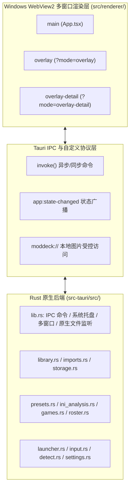
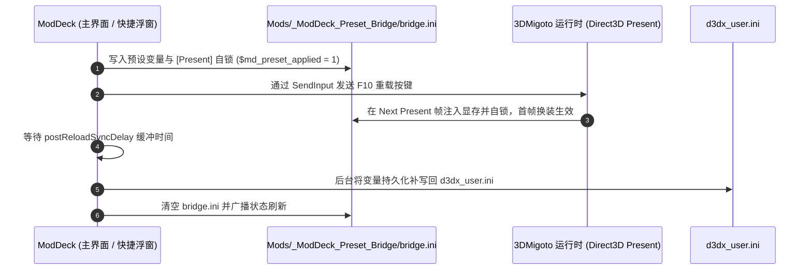

# ModDeck 架构设计与系统原理

[English (ARCHITECTURE.md)](ARCHITECTURE.md)

## 1. 目标与设计原则

1. **专注磁盘治理，绝不侵入游戏底层**：
   - ModDeck 仅负责游戏 `Mods` 目录组织、封面裁切及 `d3dx_user.ini` / `d3dx.ini` / `bridge.ini` 文本参数读写；
   - Direct3D 拦截与着色器渲染完全由 3DMigoto / XXMI 承担，ModDeck 不向游戏进程注入 DLL、不读写游戏内存、不修改游戏客户端可执行文件。
2. **磁盘即真相（Disk as Source of Truth）**：
   - 分类目录与 Mod 列表直接扫描自物理磁盘，无需依赖外网服务器或静态白名单。
3. **本地优先（Local-First）**：
   - 配置、预设、方案、封面与覆盖备份全部保存在本地设备，离线可用、零遥测上传。

---

## 2. 游戏 `Mods` 目录规范

```text
Mods/
├── 角色分类A/                      # 第一级角色归属目录
│   ├── 某个Mod/                    # 已启用 Mod
│   │   ├── mod.ini                 # 3DMigoto 声明与持久化变量
│   │   └── preview.png             # 可选预览封面
│   └── DISABLED_另一个Mod/         # 已禁用 Mod（DISABLED_ 前缀）
├── 角色分类B/
├── Characters/                     # 兼容嵌套层级容器
└── _ModDeck_Preset_Bridge/         # 运行时一次性帧桥接（以 _ 开头对扫描隐身）
    └── bridge.ini                  # [Present] 阶段变量注入脚本
```

- **启停原理**：对目录增减 `DISABLED_` 前缀（依赖 `d3dx.ini` 的 `exclude_recursive = DISABLED*` 规则）；当游戏运行锁定外层目录时，自动降级重命名内部 `.ini` 为 `DISABLED_*.ini`。
- **隐身前缀**：以 `.` 或 `_` 开头的目录自动跳过扫描。

---

## 3. 本地数据目录结构

数据统一存放于 `%APPDATA%\ModDeck\`（若 AppData 不可写，自动降级至 `ModDeck.exe` 同级 `ModDeck-data\`）：

| 文件 / 目录 | 职责说明 |
| --- | --- |
| `settings.json` | 游戏路径、开关偏好、自定义游戏、热键与变量过滤规则 |
| `roster-presets.json` | 双分池全角色阵容搭配方案 |
| `presets/{gameId}/{character}/{mod}.json` | 按游戏/角色/Mod 解耦的单 Mod 变体预设 |
| `characters.json` | 自定义显示名、别名、排序与显隐元数据 |
| `roster-cache.json` | 角色中英文词典远端同步缓存 |
| `covers/{game}/{hash}.png` | 用户裁切生成的 1:1 分类头像封面 |
| `backups/` | Mod 覆盖前自动备份与导入配置包前自动快照 |
| `languages/` | 用户外挂或社区语言包 `.json` 目录 |
| `tmp/` | 解压解析与网页拖放暂存目录（结束或启动时自动回收） |
| `logs/tauri-crash.log` | 启动与运行时异常日志 |

---

## 4. Tauri 2 + Rust 进程架构



### Rust 模块职责（`src-tauri/src/`）

- `lib.rs` / `main.rs`：应用生命周期、WebView2 运行库注册表预检、`EBWebView-recovery` 权限回退、单实例互斥、系统托盘（`tray-icon`）、三窗口协同调度（`main` / `overlay` / `overlay-detail`）、`moddeck://` 协议、Win32 `FindFirstChangeNotificationW` 目录与 `d3dx_user.ini` 监听，以及代次防抖自动重载/延迟刷盘计时器。
- `library.rs`：目录扫描、`DISABLED_` 目录与锁降级 `.ini` 启停、预览图检索、详情统计以及带 `[Section]` 上下文的热键提取（`hold` / `modifier-hold` / `mouse` 分类识别）。
- `imports.rs`：流式解压（`zip` / `sevenz-rust` / `unrar`）、多编码乱码自动纠偏、加密压缩包密码验证会话、目标目录重命名及手选覆盖目标备份（兼容 `DISABLED_<同名>` 备份）。
- `presets.rs` / `ini_analysis.rs`：实机变量采样、出厂 `Default` 基线合成、`bridge.ini` 注入、`PendingQueueState` 聚合队列、INI `persist` 静态诊断以及全库 Shader/Texture Hash 与 FX 插件冲突审计。
- `launcher.rs` / `input.rs` / `detect.rs`：`XXMI Launcher.exe --nogui --xxmi` 与官方启动器拉起（含 `ShellExecuteW` UAC 提权回退）、`CreateToolhelp32Snapshot` 进程检测、`SendInput` 扫描码按键模拟，以及注册表与 `XXMI Launcher Config.json` 路径自动探测。
- `storage.rs`：存储空间占用统计、覆盖备份一键还原/删除/过期清理、系统回收站移除（`trash`）以及 `.moddeck-bundle` 配置包导出导入。

---

## 5. `[Present]` 一次性帧桥接时序



---

## 6. 安全与隔离边界

- **路径越界拦截**：所有磁盘操作先做单段文件名清洗并检验 `is_inside` 祖先包含关系，防止路径穿越越界到配置目录之外。
- **图片协议白名单**：`moddeck://` 协议仅放行 `%APPDATA%\ModDeck\covers\` 与已配置合法 `Mods` 根目录内的图片扩展名文件。
- **回收站安全删除**：移除 Mod 与备份优先调用操作系统回收站，杜绝静默永久抹除。
