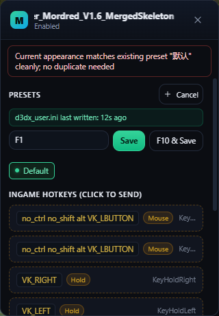

# ModDeck 后续路线图与灵感待办（Roadmap & Backlog）

[English (ROADMAP.md)](ROADMAP.md) | [更新日志 (CHANGELOG.zh-CN.md)](../CHANGELOG.zh-CN.md)

本文件作为 `v3.0.0` 之后随代码库长期演进的持久化清单，用来随时记录后续版本计划、小功能灵感、结构优化想法及待排查问题，避免跨开发周期遗忘。公开反馈或社区议题也可配合 [GitHub Issues](https://github.com/yuzhoujun/ModDeck/issues) 追踪。

---

## 已完结里程碑（归档摘要）

### v3.0.0 — Tauri 2 + Rust 架构迁移（2026-11-19 发布）

- 完成由 Electron 到 Tauri 2 + Rust + WebView2 的全功能对等迁移（便携压缩包约 3.5 MB），Electron `v2.5.0` 源码已完整保留于 `legacy/electron` 分支。
- 新增原生多格式解压与编码纠偏、INI 热键类型识别、导入升级目标手选、WebView2 前置检测及英中双语文档体系。

### v3.0.1 — Windows 安装/卸载包与旧版数据规范化（本次发布）

- 新增 Windows NSIS 安装/卸载包（`ModDeck-3.0.1-win-x64-setup.exe`），依赖标准注册表（`HKCU\Software\yuzhoujun\ModDeck`）在后续覆盖升级时自动定位安装目录，并在卸载确认页勾选「删除应用数据」时同步清理 `%APPDATA%\ModDeck\` 与 WebView2 数据（未勾选则完整保留）。
- 在应用启动探测与「设置 -> 存储与备份」新增**旧版 Electron v2 遗留残留检测与一键安全清理**（识别 `Cache`、`GPUCache`、`GrShaderCache`、`bin\ModDeckKeyHelper-v2.*`、`mod-presets.json`、v2 旧日志等，不触碰任何预设、封面、配置与 Mod 备份），同时服务安装版与免安装版用户。

---

## 计划版本：v3.1.0（方案分游戏存储、在线镜像升级与高频打磨）

- **全角色池方案（Preset Pool）按游戏拆目录与无感自动迁移**：
  - 将根目录下单文件 `%APPDATA%\ModDeck\roster-presets.json` 迁移拆分为 `%APPDATA%\ModDeck\presets\<gameId>\roster-presets.json`（与单 Mod 预设目录 `presets\<gameId>\<角色>\<Mod>.json` 保持彻底统一，多游戏互不混杂）。
  - 启动或首次读取时自动执行无感迁移，并在 `.moddeck-bundle` 导入阶段保持对 `v2.5.0` / `v3.0.x` 旧配置迁移包的向下兼容。
- **应用内版本检测与镜像源一键在线升级**：
  - 支持读取 GitHub Releases 最新版本信息，并允许用户切换或自定义 GitHub 镜像加速节点（直连 / 镜像列表自动回退）。
  - 安装版可拉取新 `ModDeck-<ver>-win-x64-setup.exe` 并结合 NSIS 注册表安装路径实现静默覆盖升级（无需额外污染系统环境变量）；便携版可一键下载新版 ZIP 并引导替换更新。
- **默认预设保留名与多语言弹窗提示修正**：
  - 修复英文界面下保存重复预设匹配 `__default__` 时提示文本仍硬编码显示汉字 `"默认"` 的问题（按当前界面语言规范显示 `"Default"` / `"默认"`），同时禁止用户在新建或编辑预设时使用保留名称 `"默认"` / `"default"`。
- **着色器缓存 `d3dx.ini` `cache_shaders` 可选开关与环境检查联动**：
  - 在「环境检查」页将 `[Rendering] cache_shaders = 1` 作为可选项（零画质损失，将编译后着色器缓存为 `.bin` 放入 `ShaderCache/` 以减少加载与重载卡顿），支持一键读写开关并联动现有的「清空 `ShaderCache`」按钮。
  - **覆盖机制确认**：实测 `XXMI Launcher Config.json` 中 `enforce_rendering` 与 `enable_hunting` 平时启动仅覆写特定键值（如 `hunting`、`track_region_hashes`），并不包含 `cache_shaders`；仅在 EFMI 更新包且开启 `overwrite_ini = true` 重 deploy `d3dx.ini` 时才可能被模板覆盖为 `0`，因此 ModDeck 只需像对待 `exclude_recursive` / `settings_auto_save_interval` 一样做检查与一键补回即可。
- **外部工具验证沙盒目录隔离（如 `Mods\EFMI-MCP\`）**：
  - 在库扫描与静态审计中支持跳过或可配置忽略外部调试工具的临时验证目录（例如 `Mods\EFMI-MCP\`），同时对齐 `ini_analysis.rs` 对 `_` 前缀目录的排除逻辑，避免开发调试时污染库视图或触发大量 Hash 碰撞误报。

---

## 计划版本：v3.2.0（INI 静态冲突审计与诊断能力升级）

- **跨 Mod `IniParams`（`x100..x255`）抢写与 `[Present]` 延迟覆写检测（高优先级）**：
  - 解析活跃 `.ini` 的 `[Present]`（及调用的 `[CommandList*]`）向全局槽位 `[xyzw](100..255)` 的写入，校验是否缺少 `$object_detected` / `$active` 等条件门控；
  - 对「无条件写入 global 寄存器」与「同时启用的 Mod B 依赖 `post run = CustomShader*` 同槽位读回」进行聚合高危/警告标注，定位冲突文件与行号。
- **Mod 冲突审计增加热键碰撞检测**：
  - 在全局审计及按角色分类审计中补充 Mod 快捷键冲突检测（与 Hash / `IniParams` / FX 插件风险清晰分区展示，保持界面层级简洁）。
- **低面数无门控 `handling = skip` 与 EFMI 旧架构兼容性提示**：
  - 仅在 `[TextureOverride*]` 同时满足小索引计数（例如 `match_index_count <= 24`）且含 `handling = skip` 但**没有任何 `$` 变量门控**时给出温和提示，防止通用场景面片误隐藏同时避免误伤常规消隐 Mod；
  - 针对终末地（`game_id == "endfield"` / `loader == "EFMI"`），检测旧版 `CrossIBClassifier` / `record_bones_cs` / `redirect_cb1_cs` 引用及 `$required_efmi_version` 声明并给出迁移提示。
- **超大 `.dds` 贴图（`> 32 MiB`）加载耗时提醒**：
  - 扫描 Mod 目录内单个超过 `32 MiB`（如 `8192×8192`）的 `.dds` 文件，在「Mod 详情 / 静态诊断」中附加 `info` 级别首帧/重载卡顿提示（与 `cache_shaders = 1` 建议互补）。
- **一键复制精简诊断上下文**：
  - 在冲突审计弹窗新增「复制精简诊断上下文（冲突 Hash / 涉及路径 / `.ini` 行号）」，方便直接粘贴给外部 AI 会话或 `EFMI-MCP` 接力排障。

---

## 长期灵感池与待查记录（Ideas & Bug Scratchpad）

> 今后随时想到的细小功能优化、边界体验问题或待修 Bug 可直接按条目追加在下方，方便下次集中迭代时逐一核销。

### 核心引擎与游戏实机适配

- **复杂 `[CommandList]` 与连续滑条变量支持**：调研针对非离散整型/浮点连续滑条及多变量条件钳制脚本的轻量 AST 解析。
- **非终末地游戏实机适配验证**：汇总鸣潮（WWMI）、崩铁（SRMI）、绝区零（ZZMI）、异环（NEMI）在社区玩家实机环境下的兼容反馈。
- **纯 Rust DDS 预览按需评估**：仅在未来确需支持直接将 `.dds` 转为缩略图或解析贴图尺寸/BC 格式时，再评估引入 `ddsfile` + `image_dds`（当前保持轻量）。
- **词典与封面离线维护流程参考**：维护 `roster.json` 与社区封面库时，可结合 `EndfieldStudio` 等外部解包/分类工具在开发侧提取新角色中英文名与立绘底图（不进客户端代码）。

### 零碎想法与待修细节

- *(后续有任何小想法或待修问题可直接追加在此处)*
